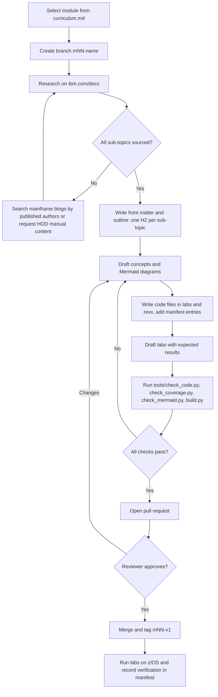

# SMP/E Course Build Workflow

Scope: one Markdown article per module in `curriculum.md` (7 modules), each covering every listed sub-topic, with Mermaid diagrams, JCL, REXX, and hands-on labs. Code lives in files under `labs/` and `rexx/`; articles include it.

## 1. Repository layout

```
articles/            source articles, with front matter and include markers
labs/mNN/{jcl,mcs,uclin}/   lab code per module
labs/env/            shared lab environment (procedure, environment spec)
labs/expected/       expected SMPOUT excerpts, added when a lab has been run
labs/manifest.json   every code file: member name, lab, verification status
rexx/                shared REXX utilities
tools/               build and check scripts
book/                generated readable articles (committed, never edited by hand)
coverage-matrix.md   generated
```

## 2. Deliverables

| File | Module |
|---|---|
| `articles/01-smpe-overview.md` | SMP/E Overview (pilot) |
| `articles/02-receive-processing.md` | RECEIVE Processing |
| `articles/03-apply-processing.md` | APPLY Processing |
| `articles/04-accept-processing.md` | ACCEPT Processing |
| `articles/05-product-maintenance.md` | Product Maintenance |
| `articles/06-additional-features.md` | Additional SMP/E Features |
| `articles/07-installing-products-and-service.md` | Installing Products and Service |
| `coverage-matrix.md` | Generated sub-topic to section traceability |
| `labs/env/lab-environment.md` | Shared lab environment specification |

## 3. Pipeline



## 4. Source hierarchy

1. IBM Docs, `ibm.com/docs`: z/OS SMP/E User's Guide (SA23-2277, `gim3000`), SMP/E Commands (`gim1000`), SMP/E Reference (`gim2000`), SMP/E Messages, Codes, and Diagnosis, z/OS Basic Skills "System installation and maintenance" (`zsysprog`), and the ServerPac, Program Directory and CBPDO documents for the delivery topics.
2. Mainframe blogs by published authors, only where IBM Docs lacks practical detail. Each use is cited.
3. `host_on_demand_contents.md` is not part of the SMP/E curriculum and is never committed to this repository (it is a client-specific manual and is listed in `.gitignore`). It is used only if the author asks for Host On-Demand as an installation example; specific chapters are then supplied for that topic.

Rules: paraphrase IBM text, never copy it in bulk; every source goes in the article front matter with the release it was checked against; version-specific behavior is labelled with the SMP/E release (current docs cover SMP/E V3R7).

## 5. Article template

File: `articles/NN-name.md`.

Front matter (required):

| Field | Content |
|---|---|
| `module` | Module number, equal to the position in `curriculum.md` |
| `title` | Module title, equal to the curriculum heading |
| `status` | `draft`, `reviewed` or `frozen` |
| `smpe_release` | SMP/E release the content targets |
| `last_verified` | Date sources were checked against ibm.com/docs, or `null` |
| `objectives` | Course objectives the module covers |
| `subtopics` | The curriculum sub-topics, verbatim and in order |
| `heading_overrides` | Optional map from a curriculum sub-topic to its H2 text, used only to correct typos in the curriculum |
| `labs` | List of `id` (`MNN-LNN`), `title`, `depends_on` |
| `sources` | List of `title`, `url`, `release` |

Body:

1. `# Module N: Title`, then Module goals.
2. One H2 per curriculum sub-topic, in curriculum order, each containing:
   - Concept explanation
   - Mermaid diagram where the topic involves flow, structure, or relationships (inline in the article)
   - Example: a code file via `<!-- include: path -->`, or an inline block of five lines or fewer for a command fragment
   - Failure modes and messages where relevant
3. `## Hands-on labs` with one `### MNN-LNN: Title` heading per lab: goal, prerequisites, steps, expected output, verification, troubleshooting, rollback.
4. `## Review questions`.
5. `<!-- sources -->` as the last line; the build generates the Sources list from the front matter.

## 6. Code and lab conventions

- Fictional product XYZ (FMID `HXYZ110`) delivered as inline-MCS text elements, so labs run on any z/OS system without IBM media.
- High-level qualifier `SMPE.LAB` for all lab data sets; zones `GLOBAL`, `TGT1`, `DLB1`; SREL `Z038`.
- Real IBM product examples (CICS, Db2, etc.) appear in Module 7 as procedures using `RECEIVE ORDER`, `FIXCAT`, and `REPORT MISSINGFIX`, not as runnable labs.
- File names: `MNNLNN-MEMBER.ext` for lab code, `MEMBER.ext` for shared code, where `MEMBER` is the z/OS member name (1 to 8 characters, `A-Z 0-9 @ # $`). Extensions: `.jcl`, `.mcs` (MCS packages for `SMPPTFIN`), `.smpcntl` (SMP/E commands for `SMPCNTL`), `.rexx`.
- Every code file is ASCII, has no tabs, and has no line over 80 columns.
- Member names are unique per kind (JCL, MCS, SMP/E command input, REXX) across all modules, except procedures under `labs/env/proc/`.
- Every code file has an entry in `labs/manifest.json`. `verified` stays `false` until someone has run the file on z/OS and recorded `verified_on`, `verified_by` and `zos_release`.
- Placeholders are written `&VOL` and the job card is `ACCT`; each file's article text says what to replace.

## 7. Shared REXX utilities

| Utility | Introduced in | Purpose |
|---|---|---|
| `SMPEJOB` | Module 1 | Build and submit a one-step GIMSMP job for a zone and command |
| `SMPESCAN` | Module 1 | Scan SMPOUT for GIM messages, severity counts, highest return code |
| `SMPEMCS` | Module 2 | Pre-check an MCS member: statement periods, 7-character IDs, `++VER` present |
| `SMPEHOLD` | Module 5 | Extract error and system holds from REPORT output |
| `SMPEPREQ` | Module 5 | Summarize unresolved prerequisite and requisite conditions |

## 8. Verification

Automated (run in CI and before every pull request):

| Script | Checks |
|---|---|
| `tools/check_code.py` | Manifest completeness, ASCII, tabs, 80 columns, JCL names, REXX header, member names, include targets |
| `tools/check_coverage.py --write` | Front matter and H2s match `curriculum.md`, lab headings match front matter, regenerates `coverage-matrix.md` |
| `tools/check_mermaid.py` | Every Mermaid block renders with `mmdc` |
| `tools/build.py` | Includes resolve and `book/` builds; CI fails if the committed `book/` is out of date |

Manual (reviewer):

- JCL and SMP/E command syntax checked against the Commands and Reference books.
- Each lab has expected results and a rollback path.
- Each course objective is exercised by at least one lab across the set.
- No emoji, no filler, no appendices.

## 9. Objective coverage plan

| Objective | Primary module(s) |
|---|---|
| What SMP/E is, installation process | 1 |
| Install products and service in z/OS | 2, 3, 4, 7 |
| Identify and correct installation problems | 3, 4, 5 |
| Configuration and control options | 1, 2, 6 |
| Delivery options (ServerPac, CBPDO, ESO, RSU) | 1, 7 |
| Interpret SMP/E output | all, using `SMPESCAN` |
| Resolve maintenance conflicts with reports | 5, 6 |
| Missing PRE, REQ, IFREQ | 5, 6 |
| Resolve error holds (automatic and manual) | 5 |
| Cross-zone installation | 6 |

## 10. Branching and release

- `main` holds only reviewed work.
- One branch per module (`m02-receive`), one pull request per module.
- Tag an approved module `mNN-v1`; corrections after approval are `mNN-v1.1` and so on.
- Verification updates (running labs on z/OS) are separate commits that change only `labs/manifest.json` and add `labs/expected/` files.

## 11. Execution cadence

1. Pilot: Module 1 plus this workflow and the repository tooling. Review template, depth, and lab style.
2. Apply review changes to the template, then build modules 2 to 7 in order (each depends on the lab environment from the previous).
3. After module 7, run a full cross-module consistency pass: terminology, data set names, REXX utilities, coverage matrix.
