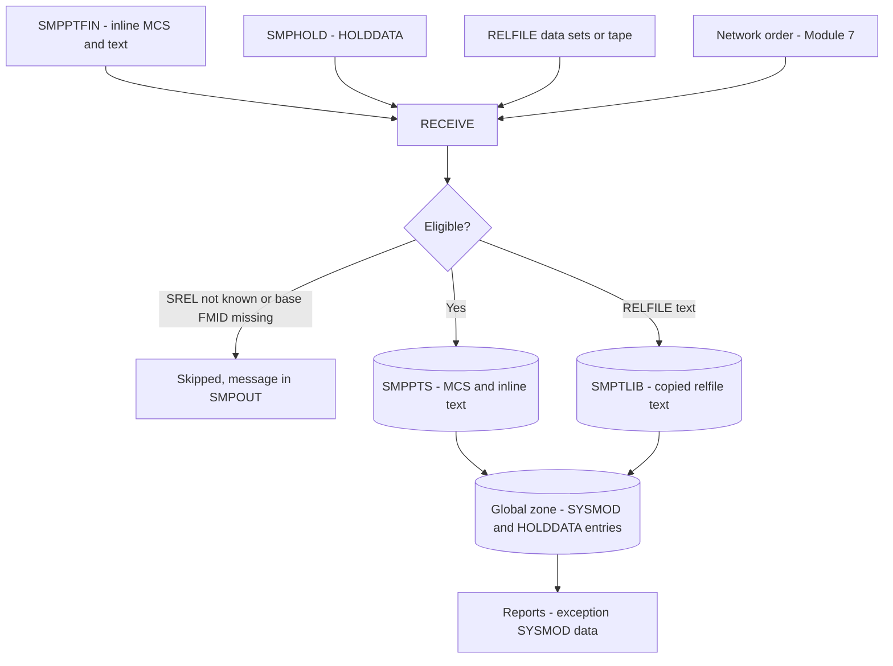
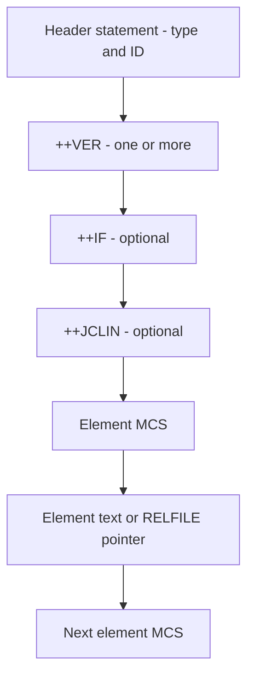
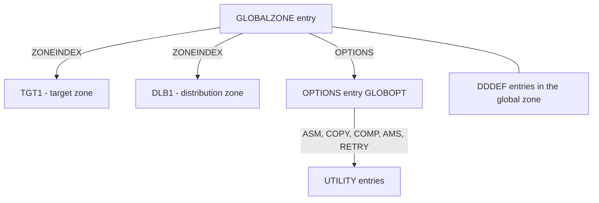
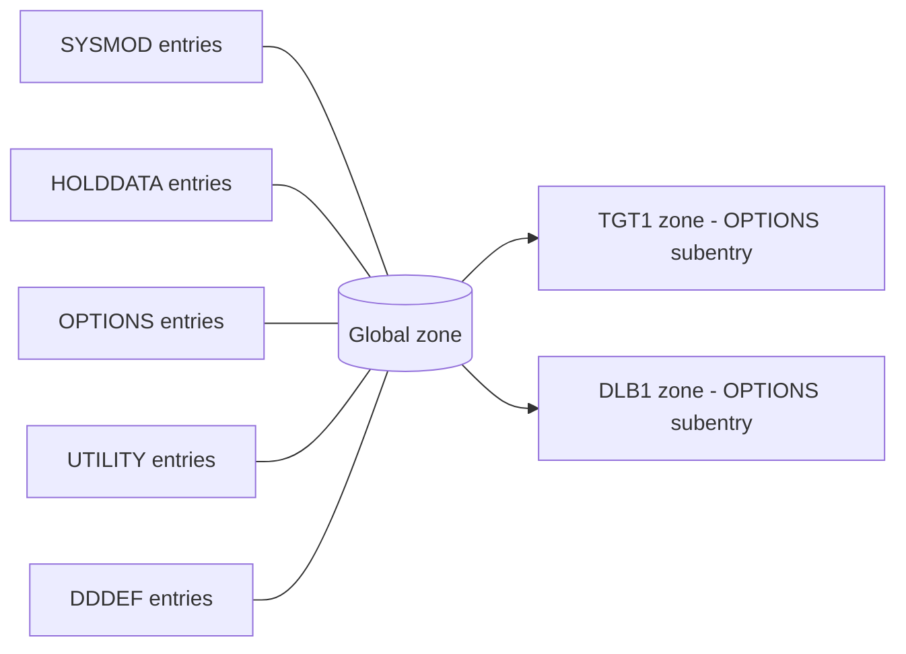
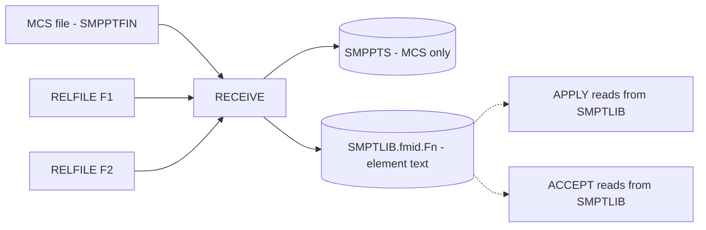
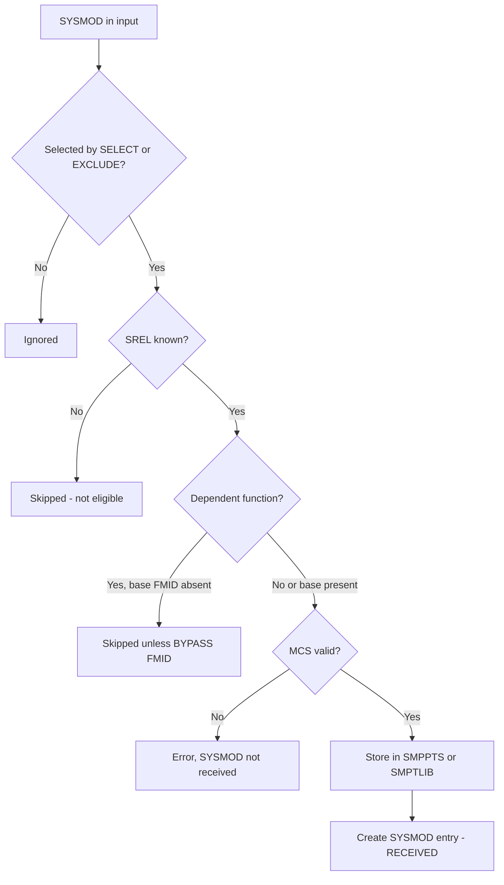
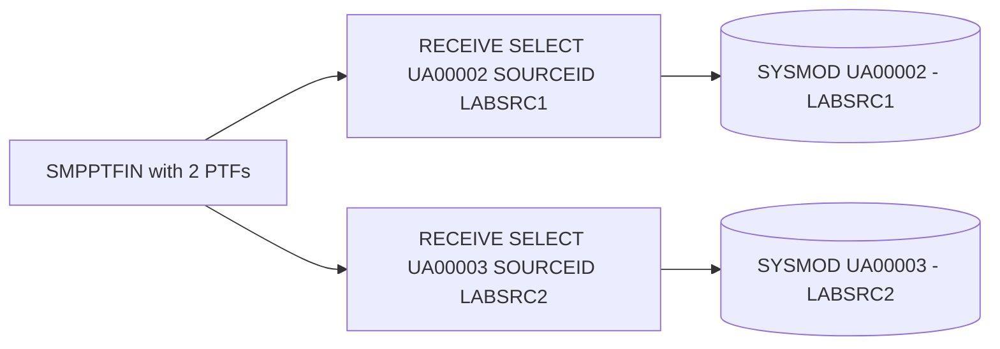
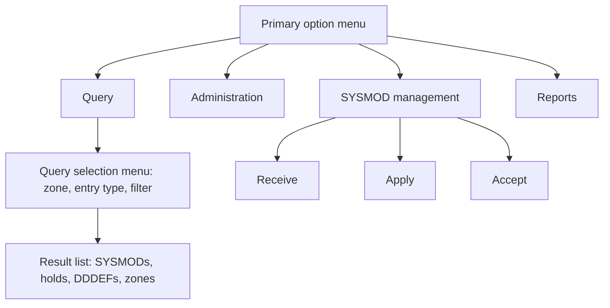

# Module 2: RECEIVE Processing

## Module goals

After this module you can:

- Describe what RECEIVE reads, what it writes, and what it never touches.
- Read and write modification control statements (MCS): header statements and the `++VER` software environment statement.
- Define the global zone entries that RECEIVE depends on: GLOBALZONE, OPTIONS, UTILITY and DDDEF.
- Create and change global zone entries with UCLIN.
- Receive SYSMODs from inline input and from relative files, and receive HOLDDATA.
- Assign SOURCEIDs and report on them.
- Explain exception SYSMODs and the three kinds of hold.
- Diagnose a SYSMOD that RECEIVE refuses.
- Find the same information in the SMP/E dialogs.

Course objectives covered: what SMP/E is and how it works, the installation process, configuration and control options, interpreting output, and the first part of delivery options (packaging and HOLDDATA).

Prerequisites: the environment from Module 1 (labs M01-L01 and M01-L02). Conventions are unchanged: high-level qualifier `SMPE.LAB`, zones `GLOBAL`, `TGT1`, `DLB1`, SREL `Z038`, fictional product XYZ, FMID `HXYZ110`. Every code file is listed in `labs/manifest.json` with its verification status, printed under each file below. A file marked `verified: no` has not been run on z/OS.

Sections listed under `unverified_topics` in this article's front matter describe entry layouts and operand lists that were not confirmed against the current SMP/E Reference. Treat them as a starting point and confirm with `LIST` output and the Reference before relying on them.

---

## The RECEIVE process

RECEIVE is the first of the three installation commands. It brings SYSMODs and HOLDDATA into SMP/E's own data sets so that later commands can select them. It works against the global zone only, so every RECEIVE job begins with `SET BDY(GLOBAL)`. It does not change a target zone, a distribution zone, or any target or distribution library.

What RECEIVE does, in order:

1. Reads the input: inline MCS and element text from `SMPPTFIN`, HOLDDATA from `SMPHOLD`, relative files from disk or tape, or an order retrieved over the network.
2. Checks eligibility. SMP/E uses the SREL on `++VER` to decide whether the SYSMOD is for an environment it knows. A dependent function is skipped unless its base function is already in the global zone, or you bypass the check with `BYPASS(FMID)`.
3. Stores the MCS and inline element text in the primary SYSMOD store, `SMPPTS`. Text delivered in relative files is copied to temporary libraries (`SMPTLIB`).
4. Creates a SYSMOD entry in the global zone, with status RECEIVED.
5. Creates HOLDDATA entries for any `++HOLD` and `++RELEASE` statements.
6. Records any SOURCEIDs, assigned by the `SOURCEID` operand or by `++ASSIGN` statements.
7. Writes reports, including the exception SYSMOD data report for SYSMODs that carry holds.

RECEIVE does not check `PRE`, `REQ` or `NPRE`. Those operands on `++VER` have no effect at RECEIVE time; they are enforced by APPLY and ACCEPT.



Data sets RECEIVE uses:

| DD | Access | Purpose |
|---|---|---|
| `SMPCSI` | Update | CSI holding the global zone |
| `SMPPTS` | Update | MCS and inline element text; defined by a global zone DDDEF |
| `SMPTLIB` | Create | Temporary libraries for relative-file text; names built from the OPTIONS `DSPREFIX` |
| `SMPLOG`, `SMPLOGA` | Write | Command log; defined by DDDEFs |
| `SMPPTFIN` | Read | SYSMODs |
| `SMPHOLD` | Read | HOLDDATA |
| `SMPNTS` | Read, write | Network cache for RECEIVE ORDER (Module 7) |
| `SMPOUT`, `SMPRPT`, `SMPLIST` | Write | Messages and reports |

`SMPNTS` is a z/OS UNIX path (`PATH='/u/...'`), not a data set.

---

## Modification Control Statements

A SYSMOD has two parts: instructions to SMP/E, and the software elements to install. The instructions are modification control statements. Each MCS starts with `++` in column 1 and ends with a period. A statement can continue over several lines. Element text (macro source, object code, data) follows the MCS that names it, and ends at the next `++` in column 1.

Classes of MCS:

| Class | Statements | Purpose |
|---|---|---|
| Header | `++FUNCTION`, `++PTF`, `++APAR`, `++USERMOD` | Name the SYSMOD and its type |
| Software environment | `++VER` | Say where the SYSMOD can be installed and what it needs |
| Conditional | `++IF` | Requisites that apply only if another FMID is present (Module 6) |
| Element | `++MAC`, `++SRC`, `++MOD`, `++DATA`, `++PROGRAM`, `++HFS`, `++JAR` | Describe an element to install |
| Element update | `++MACUPD`, `++SRCUPD`, `++ZAP` | Change an existing element |
| Installation job | `++JCLIN` | Link-edit and assembly steps for target libraries (Module 3) |
| Hold | `++HOLD`, `++RELEASE` | HOLDDATA, shipped apart from the SYSMOD |
| Assignment | `++ASSIGN` | Assign a SOURCEID to a SYSMOD |
| Descriptive | `++PRODUCT`, `++FEATURE` | Group FMIDs for reporting (Module 6) |

Shape of a SYSMOD:



A complete PTF, `UA00002`, as it would appear in `SMPPTFIN`:

<!-- include: labs/m02/mcs/UA00002.mcs -->

Failure modes at the MCS level:

- A missing period. SMP/E reads the next `++` line as part of the unfinished statement and reports a syntax error against the wrong line.
- A SYSMOD ID that is not 7 characters.
- A SYSMOD with no `++VER`. A SYSMOD needs at least one.
- Element text that begins with `++` in column 1. SMP/E treats it as a new statement.

`SMPEMCS` is a REXX pre-check for the first three. It reads an MCS member, tracks statements and periods, and prints errors with line numbers. It does not know about SRELs or FMIDs; RECEIVE still decides eligibility.

<!-- include: rexx/SMPEMCS.rexx -->

---

## MCS: header statement functions, software environment statement

The header statement says what kind of SYSMOD follows and gives its ID:

| Statement | ID | Function |
|---|---|---|
| `++FUNCTION(fmid)` | The FMID | Introduces a product or feature. The ID is the FMID. |
| `++PTF(id)` | PTF number | Preventive service for everyone |
| `++APAR(id)` | APAR number | Corrective service for one problem |
| `++USERMOD(id)` | Site chosen | Local change to an element |

Each ID is seven characters. A function may also carry `FILES(n)`, the number of relative files that accompany it, and `RFDSNPFX(prefix)`, the prefix of the relative file data set names (see Relative file packaged tapes).

The software environment statement is `++VER`. It states where the SYSMOD may be installed and what it depends on:

```
++VER(srel[,srel...]) [DELETE(...)] [FMID(...)] [NPRE(...)]
      [PRE(...)] [REQ(...)] [SUP(...)] [VERSION(...)]
```

| Operand | Meaning | Effect at RECEIVE |
|---|---|---|
| `srel` | System or subsystem release the SYSMOD is for. Four alphanumeric characters, usually a letter and three digits (`Z038` for z/OS). Required. | Used for eligibility |
| `FMID` | The function the SYSMOD belongs to. Required on every SYSMOD except a base function. Only the named SYSMOD satisfies it, not a superseding one. | A dependent function is skipped unless its base function is in the global zone, or `BYPASS(FMID)` |
| `PRE` | Prerequisites. Must be installed already or in the same run. | None |
| `REQ` | Requisites. Must be installed already or in the same run, in any order. Two SYSMODs that require each other are corequisites and install in the same command. | None |
| `NPRE` | Negative prerequisites. Valid only in functions. | None |
| `SUP` | SYSMODs this one supersedes | None at RECEIVE |
| `DELETE` | Functions removed permanently when this function installs. Valid only in functions. | None |
| `VERSION` | Functions whose elements become functionally lower than this one | None |

Rules:

- A SYSMOD has at least one `++VER` and at most 255.
- A SYSMOD that applies to more than one environment needs one `++VER` per environment. Two `++VER` statements cannot share the same SREL and FMID.
- Within one operand a SYSMOD ID cannot appear twice.

A PTF built for two system releases:

```
++PTF(UA00005) .
++VER(Z038) FMID(HXYZ110) PRE(UA00002) .
++VER(Z037) FMID(HXYZ110) PRE(UA00002) .
```

Prerequisites, requisites and supersedes are covered in Module 5. At this stage the point to retain is that RECEIVE reads `++VER` for eligibility only.

---

## The Global Zone definition entry

The global zone has one definition entry, `GLOBALZONE`. It is the entry SMP/E reads first. It does three jobs:

- Indexes the other zones. The `ZONEINDEX` subentry gives, for each zone, its name, the CSI data set that holds it, and its type (`TARGET` or `DLIB`).
- Names the OPTIONS entry that governs processing. The `OPTIONS` subentry gives the entry name.
- Identifies the system release. The `SREL` subentry is the release the zone is for.

Other subentries exist; confirm the full list in the SMP/E Reference.



---

## GZONE entry example

The Module 1 bootstrap created the entry with `ZONEINDEX` and `SREL`. Display it:

```
SET BDY(GLOBAL) .
LIST GLOBALZONE .
```

Read the output for: the `ZONEINDEX` subentries (one per zone, with the CSI data set name and type), the `OPTIONS` subentry (empty until M02-L01 adds `GLOBOPT`), and `SREL`. Compare with the UCLIN you ran in M01-L01. Any subentry present in the entry but not in that UCLIN was added later; find out by whom.

Capture the real output in `labs/expected/M02L01-LIST.txt` after you run M02-L01; this article does not reproduce it because layout varies by SMP/E level.

---

## Global Zone options entry

An OPTIONS entry holds processing choices. It lives in the global zone. The global zone, each target zone and each distribution zone name one OPTIONS entry through their own `OPTIONS` subentry, so one entry can serve many zones.

Subentries documented in the SMP/E Reference (release shown in Sources):

| Subentry | Purpose | Used by |
|---|---|---|
| `AMS` | UTILITY entry for Access Method Services | Library allocation |
| `ASM` | UTILITY entry for the assembler | Macro assembly |
| `CHANGEFILE` | Create library change file records (YES or NO) | APPLY, RESTORE |
| `COMP` | UTILITY entry for the compress utility | Library compression |
| `COMPACT` | Compact SMPPTS members (YES or NO) | RECEIVE, GZONEMERGE |
| `COPY` | UTILITY entry for the copy utility | Library copy |
| `DSPREFIX` | Prefix for SMPTLIB data set names (up to 26 characters) | RECEIVE of relative files |
| `DSSPACE` | Primary and secondary space in tracks, and directory blocks, for each SMPTLIB data set: `primary,secondary,directory` | RECEIVE of relative files |
| `EXRTYDD` | DD names ineligible for retry after an x37 abend | Space retry |
| `FIXCAT` | Fix categories whose HOLDDATA is considered | APPLY, ACCEPT, REPORT MISSINGFIX |
| `NOPURGE` | Keep SYSMOD entries, SMPPTS members and SMPTLIB data sets after ACCEPT | ACCEPT |
| `NOREJECT` | Keep the global zone SYSMOD entry after RESTORE | RESTORE |
| `PEMAX` | Maximum subentries in any CSI entry | All |
| `RETRY` | UTILITY entry for the compress after an x37 abend | Space retry |
| `RETRYDDN` | DD names eligible for retry after an x37 abend | Space retry |
| `SAVEMTS` | Keep MTS macro copies after ACCEPT (YES or NO) | ACCEPT |
| `SAVESTS` | Keep STS source copies after ACCEPT (YES or NO) | ACCEPT |

RECEIVE reads three of these: `COMPACT`, `DSPREFIX` and `DSSPACE`. The rest matter to later commands and are covered in Modules 3 to 6.

---

## options entry example

Define `GLOBOPT` and make the global zone and both lab zones use it:

<!-- include: labs/m02/uclin/M02L01-OPTIONS.smpcntl -->

What each choice does in the lab:

- `COMPACT(YES)`: SMPPTS members are stored compacted, which saves space and is normal practice.
- `DSPREFIX(SMPE.LAB.SMPTLIB)` and `DSSPACE(5,5,10)`: relative-file text lands in data sets starting `SMPE.LAB.SMPTLIB`, each with 5 tracks primary, 5 secondary and 10 directory blocks.
- `AMS`, `ASM`, `COMP`, `COPY`, `RETRY`: name the UTILITY entries defined next.

Troubleshooting: if SMP/E rejects `ADD GLOBALZONE OPTIONS(GLOBOPT)` because the subentry exists, use `REP` instead of `ADD` for that statement.

---

## Global Zone utility entry

A UTILITY entry tells SMP/E how to call a program: which program, what parameters, which DD receives its listing, and which return code is acceptable. OPTIONS subentries such as `ASM` and `COPY` name UTILITY entries. SMP/E also finds the UTILITY entry for each program that appears in JCLIN (Module 3), so entries for the linkage editor and the assembler are needed before APPLY.

Subentries used in this course:

| Subentry | Meaning |
|---|---|
| `NAME` | Program name SMP/E calls |
| `PARM` | Parameters passed to the program |
| `PRINT` | DD name that receives the program's listing |
| `RC` | Highest return code SMP/E accepts as success |

The full subentry list is in the SMP/E Reference; confirm it before adding others.

---

## Utility entry example

<!-- include: labs/m02/uclin/M02L01-UTILITY.smpcntl -->

The return codes are lab choices: the assembler and linkage editor commonly end with 4 on warnings, so `RC(4)` accepts them; `IEBCOPY` and `IDCAMS` are held to 0. Set these to your site's standards.

---

## SMP/E allocation

SMP/E needs data sets in three groups, and each must exist before the command that uses it.

| Group | Data sets | Defined by |
|---|---|---|
| Database | CSI, SMPPTS, SMPSCDS, SMPMTS, SMPSTS, SMPLTS, SMPLOG, SMPLOGA | DDDEFs, or JCL for the CSI |
| Input | SMPPTFIN, SMPHOLD, relative files | JCL or `SMPNTS` path |
| Work | SMPWRK1 to SMPWRK6, SYSUT1 to SYSUT4, SMPTLIB | DDDEFs and OPTIONS |

Module 1 allocated the database. This module adds the input data sets for the labs: a PDS for SMP/E command input (`SMPE.LAB.SMPCNTL`), a PDS for HOLDDATA (`SMPE.LAB.HOLDDATA`), and the relative-file data set for function `HXYZ120` (`SMPE.LAB.RELFILE.HXYZ120.F1`).

<!-- include: labs/m02/jcl/M02L01-ALLOCRF.jcl -->

Work data sets are allocated for the duration of one SMP/E command. They are defined with DDDEFs in the zone that the command runs against, which is why the next two sections matter.

---

## Global Zone DDDEF entry

A DDDEF entry connects a DD name that SMP/E needs to the data set, or the allocation attributes, it should use. With a DDDEF you code no DD statement for that name in the job. SMP/E allocates it when needed.

Common subentries:

| Subentry | Meaning |
|---|---|
| `DATASET` (`DA`) | Data set name |
| `PATH` | z/OS UNIX path, for UNIX elements |
| `SHR`, `OLD`, `MOD`, `NEW` | Disposition |
| `UNIT`, `VOLUME` | Allocation placement |
| `SPACE(prim,sec)`, `CYL`, `TRACK`, `DIR(n)` | Space for a data set SMP/E creates |
| `DSNTYPE`, `RECFM`, `LRECL`, `BLKSIZE` | Attributes for a data set SMP/E creates |

Two kinds of DDDEF matter at RECEIVE:

- Permanent data sets, such as `SMPPTS`, `SMPLOG` and `SMPLOGA`, defined in the global zone (done in Module 1).
- Work data sets, defined in the zone the command runs against.

The order SMP/E uses to find an allocation: a DD statement in the job wins over a DDDEF; a DDDEF is used when no DD is present.

---

## DDDEF entry example

Define the work-file DDDEFs in all three zones. The same set is needed in each zone because RECEIVE runs against `GLOBAL`, APPLY against `TGT1` and ACCEPT against `DLB1`. The space values follow the pattern in the SMP/E User's Guide cataloged-procedure sample (directory blocks on `SMPWRK1` to `SMPWRK4` and `SMPWRK6`, none on `SMPWRK5` or `SYSUT1` to `SYSUT4`); confirm them against the current guide.

<!-- include: labs/m02/uclin/M02L01-WORKDD.smpcntl -->

This closes the gap noted in `labs/env/lab-environment.md`.

---

## Review of Global Zone entries

| Entry | Names | Referenced by |
|---|---|---|
| `GLOBALZONE` | Zones and OPTIONS | Every command that starts with `SET BDY` |
| `OPTIONS` | Utility entries, SMPTLIB and compaction choices | Zones through their `OPTIONS` subentry |
| `UTILITY` | Programs, return codes, listing DD | OPTIONS and JCLIN processing |
| `DDDEF` | Data sets and allocation attributes | Any command needing that DD |
| `SYSMOD` | Received SYSMODs | RECEIVE creates; APPLY and ACCEPT read |
| `HOLDDATA` | Holds for SYSMODs | RECEIVE creates; APPLY and ACCEPT read |



---

## Creating Global Zone entries – UCLIN

UCLIN is the command that changes CSI entries directly. It is bracketed by `UCLIN .` and `ENDUCL .`, and inside it three verbs apply:

| Verb | Effect |
|---|---|
| `ADD` | Create an entry, or add subentries to an existing entry |
| `REP` | Replace an entry or subentry |
| `DEL` | Delete an entry or subentry |

Rules of use:

- UCLIN works on one zone at a time; `SET BDY` selects it first.
- UCLIN bypasses the checks the installation commands make. Use it for definitions, not for SYSMOD entries, element entries or hold entries that SMP/E maintains.
- Back up the CSI first. `ZONEEXPORT` and `ZONECOPY` (Module 6), or a full CSI copy, give you a way back.

The lab job runs the three input members together: `UTILITY`, `OPTIONS` and `WORKDD`.

<!-- include: labs/m02/jcl/M02L01-GLOBAL.jcl -->

`SMPPROC` supplies `SMPOUT`, `SMPRPT`, `SMPLIST`, `SMPSNAP`, `SMPDEBUG`, `SMPPUNCH` and the CSI. The `SMP.SMPCNTL` override replaces the procedure's dummy `SMPCNTL`. The `SMP.` prefix is the step name inside the procedure; without it the DD is not an override.

---

## Relative file packaged tapes

A product with many elements does not carry its text inline. It is packaged as an MCS file plus relative files (RELFILEs): sequential or partitioned data sets, one per kind of element, which RECEIVE copies into SMPTLIB. IBM ships products this way on tape and as disk or network downloads.

Pieces:

| Piece | Where | Purpose |
|---|---|---|
| MCS file | First file on the medium, read from `SMPPTFIN` | Header, `++VER`, element MCS with `RELFILE(n)` pointers |
| Relative files `F1`, `F2`, ... | Following files, or data sets named `prefix.fmid.Fn` | Element text and objects |
| `FILES(n)` | On the header | How many relative files belong to the function |
| `RFDSNPFX(prefix)` | On the header | Prefix of the relative file data set names, when received from disk |
| `RELFILE(n)` | On each element MCS | Which relative file holds the element |



On tape, the layout and the DD or tape-file parameters belong to each product's program directory; follow it. On disk, the lab below builds a small RELFILE-packaged function, `HXYZ120`, with one macro. The MCS points at `SMPE.LAB.RELFILE.HXYZ120.F1`:

<!-- include: labs/m02/mcs/HXYZ120.mcs -->

Build the relative file with IEBUPDTE:

<!-- include: labs/m02/jcl/M02L04-RELFILE.jcl -->

Receive it. RECEIVE finds the relative file from `RFDSNPFX` and `FILES` on the header and copies the text into a data set whose name starts with the OPTIONS `DSPREFIX`:

<!-- include: labs/m02/jcl/M02L04-RCVREL.jcl -->

Because the text stays in SMPTLIB until ACCEPT, deleting those data sets before ACCEPT breaks the install. `NOPURGE(YES)` keeps them afterwards; the default removes them after ACCEPT.

---

## Receive processing

A RECEIVE step by step, with where each part can fail:

| Step | What SMP/E does | Typical failure |
|---|---|---|
| 1 | Opens the global zone, applies OPTIONS | Zone or CSI not found; OPTIONS entry missing |
| 2 | Allocates `SMPPTS`, `SMPLOG` and work files from DDDEFs | DDDEF missing or points at a data set that does not exist |
| 3 | Reads `SMPPTFIN` and `SMPHOLD` | DD missing, wrong record format |
| 4 | Parses MCS | Missing period, bad ID, no `++VER` |
| 5 | Checks eligibility (SREL, base FMID, `SELECT` and `EXCLUDE`) | SYSMOD skipped with a message |
| 6 | Stores MCS and text; copies relative-file text to SMPTLIB | Out of space in SMPPTS or SMPTLIB |
| 7 | Creates or updates SYSMOD, HOLDDATA and SOURCEID information | Duplicate SYSMOD already received |
| 8 | Writes reports and the return code | None |

Return code behavior follows SMP/E conventions: 0 successful, 4 warnings (for example, a SYSMOD skipped), 8 or higher errors. Always read `SMPOUT`, not only the return code: RECEIVE can end with a low return code when it skipped the SYSMOD you wanted.



---

## Global Zone sysmod entry example

Display the entries RECEIVE created:

```
SET BDY(GLOBAL) .
LIST SYSMODS .
```

For each received SYSMOD, check: the SYSMOD ID and type, the status (RECEIVED), the SOURCEIDs, and the FMID. Entries for SYSMODs that have already been applied or accepted show those statuses too, because the global zone entry stays until ACCEPT removes it.

After M02-L02 the list contains `UA00002` and `UA00003` with SOURCEIDs `LABSRC1` and `LABSRC2`, and nothing is applied. Record the subentry names you see in your own output; they vary by SMP/E level.

---

## Exception sysmods

An exception SYSMOD is a SYSMOD that SMP/E will not install without an explicit decision, because HOLDDATA says something about it. HOLDDATA arrives separately from the SYSMOD, usually after it, so a SYSMOD you received without a problem can become an exception SYSMOD when new HOLDDATA is received.

| Hold type | Meaning | Bypass operand | Resolved by |
|---|---|---|---|
| ERROR | A known problem with the SYSMOD (for example a PE or HIPER APAR) | `BYPASS(HOLDERROR)` | Installing the SYSMOD that fixes the APAR, or bypassing |
| SYSTEM | The SYSMOD needs action before, during or after install | `BYPASS(HOLDSYSTEM)` | Doing the action, then bypassing with the reason ID |
| USER | A hold the installation placed itself | `BYPASS(HOLDUSER)` | Whoever placed it |
| FIXCAT | The SYSMOD belongs to a fix category (Module 7) | `BYPASS(HOLDFIXCAT)` | The category's resolving SYSMODs |

RECEIVE does not stop at an exception SYSMOD. It records the holds and lists the SYSMODs in the RECEIVE exception SYSMOD data report. APPLY and ACCEPT enforce the holds; resolving them is Module 5.

---

## Held sysmod entry example

M02-L03 receives PTF `UA00004` and the hold data in the next section. Afterwards the global zone carries a SYSMOD entry for `UA00004` and HOLDDATA entries for `UA00002`, `UA00003` and `UA00004`:

<!-- include: labs/m02/mcs/UA00004.mcs -->

<!-- include: labs/m02/jcl/M02L03-RCVHOLD.jcl -->

`SMPHOLD` carries the HOLDDATA. `SMPPTFIN` carries the SYSMOD. `RECEIVE SYSMODS HOLDDATA` processes both.

What to look for afterwards:

- `UA00004` is RECEIVED and has an ERROR hold with reason `AXYZ001`.
- `UA00003` has a SYSTEM hold with reason `ACTION`.
- `UA00002` has a USER hold with reason `CHGCTL1`.
- All three appear in the exception SYSMOD data report in `SMPRPT`.

The SYSMODs `UA00002` to `UA00004` are reserved for the holds exercises in Module 5; do not install them in other labs.

---

## HOLDDATA example

`++HOLD` statements name the SYSMOD, the FMID, the hold type and the reason, and may carry a date and a comment. `++RELEASE` withdraws a hold.

<!-- include: labs/m02/mcs/HOLDXYZ.mcs -->

Notes:

- For ERROR holds the reason ID is the APAR number. The hold is satisfied by installing a SYSMOD that supersedes that APAR (in the lab, a PTF with `SUP(AXYZ001)`).
- For SYSTEM holds the reason is one of a fixed list of IDs (for example `ACTION`); for USER holds you choose the ID.
- The APAR prefix in HOLDDATA must match the APAR SYSMOD ID. IBM's Enhanced HOLDDATA has had holds whose prefix did not match, such as `AW12345` for an `OW12345` APAR, so that the hold never matched; IBM provides a sample REXX utility to generate corrective `++RELEASE` and `++HOLD` statements.

Real HOLDDATA comes from IBM as Enhanced HOLDDATA:

| Item | Detail |
|---|---|
| Content | ERROR holds for PE and HIPER APARs, FIXCAT holds, and SECINT holds with security severity scores in the symptoms |
| Comment field | May carry the resolving PTF and HIPER reason flags (for example `DAL` data loss, `FUL` function loss, `IPL` system outage, `PRF` performance, `PRV` pervasive) |
| Files | By time span: month (30 days), quarter (90), year (365), full (730, includes FIXCATs), and a three-year binary |
| Format | Text files `RECFM=FB`, `LRECL=80`; `.bin` files `RECFM=FB`, `LRECL=1024`, uploaded as binary and unpacked with AMATERSE |
| Transfer | `RECEIVE ORDER` with `CONTENT(HOLDDATA)`, recommended from SMP/E 3.4; plain FTP was withdrawn in February 2023, so FTPS is required for file downloads |

Overlap your last download by a few days so you miss nothing.

Receiving a CBPDO or RSU with HIPER holds present: either include the `HIPER` SOURCEID in the APPLY so critical service installs together, or bypass the HIPER holds and run `REPORT ERRSYSMODS` afterwards to see what is missing:

```
APPLY S(fmid,...) FORFMID(fmid,...) SOURCEID(PRP,HIPER,...) GROUPEXTEND .
APPLY S(fmid,...) BYPASS(HOLDCLASS(HIPER)) .
```

---

## The RECEIVE command

Syntax shown here covers the operands used in this module. The full syntax diagram, usage notes and nine examples are in the SMP/E Commands book, chapter "The RECEIVE command".

```
RECEIVE [SYSMODS] [HOLDDATA] [SELECT(sysmod,...)] [EXCLUDE(sysmod,...)]
        [FORFMID(fmid,...)] [SOURCEID(id,...)] [BYPASS(...)] .
```

| Operand | Meaning |
|---|---|
| `SYSMODS` | Receive SYSMODs from `SMPPTFIN` |
| `HOLDDATA` | Receive HOLDDATA from `SMPHOLD` |
| `SELECT` | Receive only the named SYSMODs |
| `EXCLUDE` | Receive everything except the named SYSMODs |
| `FORFMID` | Limit to the named FMIDs |
| `SOURCEID` | Assign these SOURCEIDs to every SYSMOD received by this command |
| `BYPASS(FMID)` | Do not require a dependent function's base function |
| `FROMNETWORK`, `ORDER` | Receive from IBM over the network (Module 7) |

Operands the Commands book also lists for RECEIVE, such as `RFDSNPFX`, `FROMDS` and FMID-set exclusion, are not used in these labs.

Examples:

```
RECEIVE SYSMODS HOLDDATA .
RECEIVE SYSMODS SELECT(UA00002) SOURCEID(LABSRC1) .
RECEIVE SYSMODS EXCLUDE(UA00004) .
```

If the input data set holds only SYSMODs you want, `SELECT` can be omitted and SMP/E processes everything in `SMPPTFIN`.

RECEIVE ORDER is covered in Module 7. The IBM example in the Commands book names an order server, a client definition, `CONTENT(PTFS(...))` for specific PTFs and `FORTGTZONES` for a target zone; it adds `SMPNTS` for the network cache.

---

## Sysmod entry with SOURCEID example

A SOURCEID is a label attached to a SYSMOD at RECEIVE time so you can select a set of SYSMODs later without naming each one. Use one per delivery (`PUT2611`), per task (`TASK4471`) or per recipient. SOURCEIDs come from two places: the `SOURCEID` operand on RECEIVE, and `++ASSIGN` statements in the input (IBM ships these with service, for example for PUT and RSU levels).

The lab receives two PTFs with different SOURCEIDs:

<!-- include: labs/m02/jcl/M02L02-RCVPTF.jcl -->

The input data sets named in `SMPPTFIN` are concatenated; `SELECT` picks one PTF per RECEIVE. After the run, `LIST SYSMODS` shows `UA00002` with SOURCEID `LABSRC1` and `UA00003` with `LABSRC2`.

Later commands can select by SOURCEID. For example, `APPLY SOURCEID(LABSRC1) ...` applies everything labeled `LABSRC1` (APPLY is Module 3).



---

## REPORT SOURCEID output examples

`REPORT SOURCEID` reads the global zone and reports, for each SOURCEID, the SYSMODs that carry it. Use it to see what a delivery contained and what is still unapplied.

<!-- include: labs/m02/jcl/M02L02-RPTSRC.jcl -->

Operands for restricting the report exist; see the Commands book.

After M02-L02, the report must show:

| SOURCEID | SYSMODs |
|---|---|
| `LABSRC1` | `UA00002` |
| `LABSRC2` | `UA00003` |

If either SOURCEID is missing, the RECEIVE for that PTF failed or ran without its `SOURCEID` operand. Capture the real output in `labs/expected/M02L02-RPTSRC.txt`. This article does not reproduce the report layout because it was not captured on a live system.

---

## SMP/E dialogs primary option menu & query selection menus

The SMP/E dialogs are ISPF panels that build and run SMP/E jobs. They cover the same ground as the commands in this module: define the CSIs and zones, query entries, receive SYSMODs, install them, and run reports. How you start them is site-specific; ask your system programmer for the name of the CLIST or EXEC.

Structure to expect:



Names and option numbers differ by SMP/E level; verify on your system. Two ideas carry across levels:

- The dialog needs to know the global zone's CSI first (the "SET BOUNDARY" equivalent). Every query runs against the zone you chose.
- The query selection menu builds a `LIST` command from your choices. Use it to see the generated command and compare it with what you would type in batch.

---

## Hands-on labs

### M02-L01: Define the global zone entries

Goal: create the UTILITY entries, the OPTIONS entry and the work-file DDDEFs, and verify them.

Prerequisites: M01-L01 complete (zones exist).

Steps:

1. Run `M02L01-ALLOCRF` (shown under SMP/E allocation). Replace `&VOL` first.
2. Upload `M02L01-UTILITY`, `M02L01-OPTIONS` and `M02L01-WORKDD` (`.smpcntl` files) to `SMPE.LAB.SMPCNTL` as members `UTILITY`, `OPTIONS` and `WORKDD`.
3. Run `M02L01-GLOBAL` (shown under UCLIN).
4. Run `M02L01-LIST`:

<!-- include: labs/m02/jcl/M02L01-LIST.jcl -->

Expected result: `M02L01-GLOBAL` ends with return code 0. `M02L01-LIST` shows: `OPTIONS` subentry `GLOBOPT` on the global zone and both lab zones; `GLOBOPT` with the subentries from the options example; four UTILITY entries; the ten work DDDEFs in the global zone and in `TGT1`.

Verification: run `SMPESCAN` on the SMPOUT of both jobs. Save the LIST output to `labs/expected/M02L01-LIST.txt`.

Troubleshooting: a message that a subentry already exists means use `REP`; a message that a zone was not found means the zone name or CSI in `ZONEINDEX` does not match.

Rollback: `DEL OPTIONS(GLOBOPT)` and `DEL UTILITY(...)` under UCLIN, plus `REP GLOBALZONE` without the `OPTIONS` subentry. Better: restore the CSI from the backup you took before this lab.

### M02-L02: Receive PTFs and assign SOURCEIDs

Goal: receive two PTFs with different SOURCEIDs and report on them.

Prerequisites: M02-L01 complete.

Steps:

1. Upload `UA00002.mcs` and `UA00003.mcs` to `SMPE.LAB.SMPPTFIN` as members `UA00002` and `UA00003`.
2. Run `SMPEMCS` against each member. Expected: no errors.
3. Run `M02L02-RCVPTF` (shown under Sysmod entry with SOURCEID example).
4. Run `M02L02-RPTSRC` (shown under REPORT SOURCEID).

Expected result: both RECEIVE commands end with return code 0. `LIST SYSMODS` shows `UA00002` and `UA00003` in RECEIVED status. The report matches the table in the REPORT SOURCEID section. No library or zone other than the global zone changed.

Verification: browse `SMPE.LAB.SXYZMAC(XYZMAC1)`: still at the level M01-L03 left it.

Troubleshooting: if `UA00001` is not accepted from M01-L03, nothing here breaks; RECEIVE does not check `PRE`.

Rollback: `REJECT SELECT(UA00002,UA00003) .` in the global zone.

### M02-L03: Receive HOLDDATA and find the exception SYSMODs

Goal: see HOLDDATA turn received SYSMODs into exception SYSMODs.

Prerequisites: M02-L02 complete.

Steps:

1. Upload `UA00004.mcs` to `SMPE.LAB.SMPPTFIN(UA00004)` and `HOLDXYZ.mcs` to `SMPE.LAB.HOLDDATA(HOLDXYZ)`.
2. Run `M02L03-RCVHOLD` (shown under Held sysmod entry example).
3. Open the RECEIVE exception SYSMOD data report in `SMPRPT`.
4. Run `M02L03-LISTHLD`:

<!-- include: labs/m02/jcl/M02L03-LISTHLD.jcl -->

Expected result: return code 0 or 4. The exception report lists `UA00002`, `UA00003` and `UA00004` with their hold types and reasons. `LIST HOLDDATA` shows the three holds.

Record: for each hold, the type, the reason, and which operand on APPLY would bypass it.

Troubleshooting: if holds for `UA00002` and `UA00003` are not listed, check that `SMPHOLD` points at the member and that those PTFs are in the global zone.

Rollback: `REJECT SELECT(UA00004) HOLDDATA .` removes the PTF and its holds; confirm the operand in the Commands book.

### M02-L04: Receive a RELFILE-packaged function

Goal: receive a function whose element text is delivered in a relative file, and find the text in SMPTLIB.

Prerequisites: M02-L01 complete.

Steps:

1. Confirm `SMPE.LAB.RELFILE.HXYZ120.F1` was created by `M02L01-ALLOCRF`.
2. Run `M02L04-RELFILE` (shown under Relative file packaged tapes).
3. Upload `HXYZ120.mcs` to `SMPE.LAB.SMPPTFIN(HXYZ120)`.
4. Run `M02L04-RCVREL`.
5. In ISPF 3.4, list `SMPE.LAB.SMPTLIB.*`.

Expected result: RECEIVE ends with return code 0. A data set whose name starts `SMPE.LAB.SMPTLIB` exists and contains member `XYZMAC2`. `SMPPTS` contains the MCS for `HXYZ120` but not the macro text.

Troubleshooting: if SMP/E cannot find the relative file, compare `RFDSNPFX`, the FMID and `F1` against the data set you built; the name must be `prefix.fmid.Fn`. If the SMPTLIB allocation fails, check `DSPREFIX` and `DSSPACE` in `GLOBOPT`.

Rollback: `REJECT SELECT(HXYZ120) .` then delete the SMPTLIB data sets if they remain.

### M02-L05: Diagnose SYSMODs that RECEIVE refuses

Goal: learn the three ways RECEIVE refuses input and where each shows in the output.

Prerequisites: M02-L01 complete.

Steps:

1. Upload `UA00097.mcs`, `UA00098.mcs` and `JXYZ111.mcs` to `SMPE.LAB.SMPPTFIN` under the same member names.
2. Run `SMPEMCS` on `UA00097`. Expected: an error that a statement has no terminating period.
3. Run `M02L05-RCVBAD`:

<!-- include: labs/m02/jcl/M02L05-RCVBAD.jcl -->

Then run `SMPESCAN` on each step's output. For each step, record: highest return code, the messages that explain what happened, and whether `LIST SYSMODS` shows the SYSMOD.

Expected result:

| Package | Fault | Expected outcome |
|---|---|---|
| `UA00097` | `++VER` has no period | MCS syntax error; not received |
| `UA00098` | SREL `Z999` is not an SREL SMP/E knows | Not eligible; not received |
| `JXYZ111` | Dependent function; base `HXYZ999` is not in the global zone | Skipped; not received |

Troubleshooting: a return code of 4 with no SYSMOD received is the normal outcome for the last two; the message text, not the code, tells you which rule applied.

Look up each message ID in the SMP/E Messages, Codes, and Diagnosis book.

### M02-L06: Query the global zone with the SMP/E dialogs

Goal: repeat three queries from this module with the dialogs, and compare with the batch results.

Prerequisites: M02-L03 complete; the dialogs are installed on your system.

Steps:

1. Start the SMP/E dialogs as your site documents.
2. Identify the global zone CSI `SMPE.LAB.CSI` and select the global zone.
3. Query SYSMODs; filter to RECEIVED status.
4. Query HOLDDATA entries.
5. Query DDDEFs in the global zone.
6. For each query, view or save the command the dialog generated and compare it with the commands in `M02L01-LIST` and `M02L03-LISTHLD`.

Expected result: the dialog lists `UA00002` to `UA00004` and `HXYZ120`, the same three holds as `LIST HOLDDATA`, and the DDDEFs defined in M02-L01.

Record: the menu path you used for each query, so the next reader of this repository can follow it. Add it to `labs/expected/M02L06-dialog-path.txt`.

---

## Review questions

1. Which zone does RECEIVE update? Which libraries does it change?
2. A PTF names `PRE(UA00001)` and `UA00001` is not installed. Does RECEIVE refuse the PTF? Which command detects the problem?
3. What does the SREL on `++VER` decide at RECEIVE time?
4. A function names `FMID(HXYZ999)` on `++VER` and `HXYZ999` is not in the global zone. What happens at RECEIVE, and which operand overrides it?
5. Which three OPTIONS subentries does RECEIVE read? What does each do?
6. Why are work-file DDDEFs needed in the target and distribution zones as well as the global zone?
7. What makes a SYSMOD an exception SYSMOD? Give one way a SYSMOD becomes one after it was received.
8. State the bypass operand for each of ERROR, SYSTEM and USER holds.
9. Where does the text of a RELFILE-packaged element live after RECEIVE, and what happens if you delete that data set before ACCEPT?
10. Why should you read `SMPOUT` and not only the return code after a RECEIVE?
11. Give two uses of a SOURCEID.

---

<!-- sources -->
