# Module 3: APPLY Processing

## Module goals

After this module you can:

- Prepare the target zone and its DDDEF entries for an APPLY.
- Write the MCS for macro, source, module and data elements, and read the JCLIN that ties modules to load modules.
- Explain how JCLIN creates MOD, LMOD, ASSEM and DLIB entries, and run the JCLIN command.
- Explain what the save control data set holds and why RESTORE needs it.
- Explain how SMP/E finds target libraries and builds the SYSLIB concatenation for assemblies.
- Install a function and a PTF with APPLY CHECK followed by APPLY, and read the results in the target zone.
- Explain element service level.
- Install a dependent function, and replace a function with another function that deletes it.
- Diagnose a SYSMOD that APPLY refuses.
- Find the same actions in the SMP/E dialogs.

Course objectives covered: the installation process, installing products and service, identifying and correcting installation problems, configuration and control options, and interpreting output.

Prerequisites: the environment from Modules 1 and 2. Conventions are unchanged: high-level qualifier `SMPE.LAB`, zones `GLOBAL`, `TGT1`, `DLB1`, SREL `Z038`, fictional product XYZ, FMID `HXYZ110`. Every code file is listed in `labs/manifest.json` with its verification status, printed under each file below. A file marked `verified: no` has not been run on z/OS.

State this module expects on entry:

| Item | State |
|---|---|
| `HXYZ110` | Installed in `TGT1` and `DLB1` (M01-L02) |
| `UA00001` | As left by M01-L03; not needed here |
| `UA00002`, `UA00003` | Received with SOURCEIDs `LABSRC1` and `LABSRC2` (M02-L02) |
| `UA00004` | Received with HOLDDATA for `UA00002` to `UA00004` (M02-L03) |
| `HXYZ120` | Received from a relative file, not applied (M02-L04) |
| OPTIONS, UTILITY, work-file DDDEFs | Defined in all three zones (M02-L01) |

`UA00002` to `UA00004` are reserved for the Module 5 holds exercises. Every APPLY in this module uses `SELECT`. Never run a mass-mode APPLY (one without `SELECT`) in this environment: it would select those PTFs. New SYSMODs in this module use the IDs `JXYZ112`, `HXYZ121` and `UA00010` to `UA00012`, and the SOURCEID `LABM03`. No lab here runs ACCEPT; Module 4 accepts what this module applies.

Sections listed under `unverified_topics` in this article's front matter describe entry layouts, operands and report layouts that were not confirmed against the SMP/E Reference or User's Guide. Treat them as a starting point and confirm with `LIST` output and the Reference before relying on them. The APPLY and JCLIN command chapters and the Reference entries were read in the z/OS 2.1 and 2.2 editions (see Sources); recheck them against the current release.

Two carry-overs from earlier modules affect this one:

- The `GLOBALZONE` entry created in M01-L01 carries `FMID(HXYZ110)`. Its effect on RECEIVE of `JXYZ112` (which names `FMID(HXYZ110)`) is unconfirmed. M03-L03 troubleshooting covers the symptom.
- M01-L01 defines `DDDEF(SMPLTS)` in `DLB1`, not in `TGT1`. APPLY uses `SMPLTS` for CALLLIBS processing, so this module adds it to `TGT1`. Review it when Module 6 covers CALLLIBS.

---

## Product function & Installation methods

A function SYSMOD, introduced by `++FUNCTION`, delivers a product or a feature of one. Its ID is its FMID. A base function names no `FMID` on `++VER`. A dependent function names the FMID of the base it needs. APPLY installs a function into the target libraries and records it, and the elements it brought, in the target zone.

Installation methods, as far as this module goes:

| Method | Covered in |
|---|---|
| RECEIVE, APPLY, ACCEPT run by you with SMP/E commands | Modules 2 to 4; this module is the APPLY step |
| Products delivered already installed or with generated jobs (ServerPac, CustomPac, CBPDO) | Module 7 |

With the RECEIVE-APPLY-ACCEPT method the User's Guide describes the APPLY step as three jobs: receive any additional HOLDDATA, run APPLY CHECK, then run APPLY. Apply the function, its PTFs and its requisites in one APPLY command where you can, so that SMP/E sees the whole set.

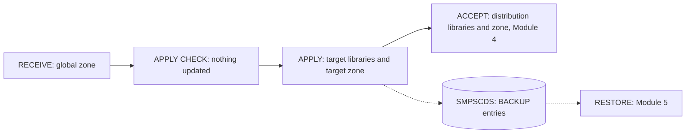

Prepare before you APPLY:

- Add DDDEF entries to the target and distribution zones, and allocate any library the function adds.
- Work on a copy of the production target libraries and zones first. APPLY updates the system libraries.
- Take a backup you can return to. The lab job saves the CSI, `SMPSCDS`, `SMPPTS` and the four target libraries this module changes. Each run replaces the previous backup, so rerun it before any lab that you cannot undo with RESTORE:

<!-- include: labs/m03/jcl/M03L01-BACKUP.jcl -->

---

## Target Zone definition entry

The target zone has one definition entry, `TARGETZONE`. It is the first entry SMP/E reads when a command runs after `SET BDY(zone)`. The entry carries the subentries the labs have used so far:

| Subentry | Meaning | Set in |
|---|---|---|
| `SREL` | System release the zone is for | M01-L01 |
| `RELATED` | The distribution zone built from the same product libraries | M01-L01 |
| `OPTIONS` | The OPTIONS entry (in the global zone) that governs processing | M02-L01 |

The Reference lists further subentries for the target zone. They were not confirmed for this article; read the Reference and your own `LIST` output.

The zone holds everything APPLY records:

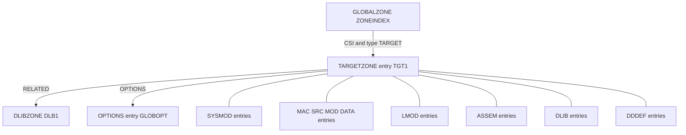

The global zone locates the target zone through its `ZONEINDEX` subentry. A target zone without a `ZONEINDEX` entry in the global zone is not found.

---

## TZONE entry example

Display the target zone entry:

<!-- include: labs/m03/jcl/M03L01-LISTTZ.jcl -->

The same job lists the DDDEFs in the zone and the `SYSLIB` DDDEF defined later in this module. Read the target zone entry for `SREL` (`Z038`), `OPTIONS` (`GLOBOPT`) and `RELATED` (`DLB1`). Record any other subentry you see and compare it with the UCLIN you ran in M01-L01 and M02-L01. Save the output to `labs/expected/M03L01-LISTTZ.txt`; this article does not reproduce it because the layout was not captured on a live system.

---

## Target Zone DDDEF entry

M02 introduced the DDDEF entry. A DDDEF names a DD that SMP/E needs and gives the data set or the allocation attributes. SMP/E looks for a DD statement in the job first and for a DDDEF in the zone the command runs against only if there is no DD statement.

APPLY runs against the target zone, so every library it reads or writes needs a DDDEF in the target zone, including the distribution libraries that appear in JCLIN link-edit and copy steps:

| DDDEF | Data set | Why APPLY needs it | Defined in |
|---|---|---|---|
| `SXYZMAC`, `SXYZSRC` | Target macro and source libraries | APPLY writes macros and source there | M01-L01 |
| `SXYZLOAD` | Target module library | Output of the link-edit in JCLIN | this module |
| `SXYZDATA` | Target data library | Output of the copy step in JCLIN | this module |
| `AXYZMOD` | Distribution module library | Named by `INCLUDE` in the JCLIN link-edit | this module |
| `AXYZMAC` | Distribution macro library | Last entry of the SYSLIB concatenation | this module |
| `AXYZDATA` | Distribution data library | Input of the copy step in JCLIN | this module |
| `SMPSCDS`, `SMPMTS`, `SMPSTS` | SMP/E data sets | Backup entries; macros and source not in a target library | M01-L01 |
| `SMPLTS` | SMP/E data set | CALLLIBS processing | this module |
| `MACLIB`, `MODGEN` | System macro libraries | Assemblies | this module |
| `SYSLIB` | Concatenation | Assembler macro library | this module |
| `SMPWRK1` to `SMPWRK6`, `SYSUT1` to `SYSUT4` | Work data sets | All commands | M02-L01 |

Two elements arrive through a DD statement and not a DDDEF in these labs: an object text library named by `TXLIB`, and a library of link-edited modules named by `LKLIB`. The User's Guide says APPLY and ACCEPT need a DD for the `LKLIB` or `TXLIB` ddname when a SYSMOD is packaged that way. The lab jobs add `SMP.XYZOBJ DD` for `TXLIB(XYZOBJ)`.

A missing DDDEF is one of the errors APPLY CHECK reports before anything is installed. M03-L07 provokes it.

Allocate the new libraries before you define their DDDEFs:

<!-- include: labs/m03/jcl/M03L01-ALLOCLIB.jcl -->

`SXYZDATX` is allocated here but deliberately left without a DDDEF. M03-L07 uses it.

---

## Target Zone DDDEF entry example

The DDDEFs for the target zone, including the `SYSLIB` concatenation covered later in this module:

<!-- include: labs/m03/uclin/M03L01-TZDDDEF.smpcntl -->

Run it with the same pattern as M02-L01:

<!-- include: labs/m03/jcl/M03L01-TZRUN.jcl -->

`MACLIB` and `MODGEN` use the standard system data set names. Change them if your site names them differently. If a DDDEF already exists, SMP/E rejects the `ADD`; use `REP` for that entry.

---

## MAC, SRC, and MOD element MCS

Element MCS describe each element a SYSMOD installs. This module uses three kinds in one function and a fourth in the next section.

| Statement | Element | Text delivered |
|---|---|---|
| `++MAC` | Macro | Inline in the package, or in `RELFILE`, `TXLIB` |
| `++SRC` | Assembler or other source | Inline, or in `RELFILE`, `TXLIB` |
| `++MOD` | Module (object or link-edited) | Object text inline, or in `RELFILE`, `TXLIB`; link-edited text in `LKLIB` |

Operands that the Reference documents for these statements:

| Operand | Meaning |
|---|---|
| `DISTLIB(ddname)` | Distribution library. Required when the element is first recorded. `SYSPUNCH` is not allowed. |
| `SYSLIB(ddname)` | Target library, updated by APPLY and RESTORE. If it conflicts with an existing entry, SMP/E ignores it unless `++MOVE` is used. |
| `TXLIB(ddname)` | Partitioned data set that holds the element. `SMPTLIB` cannot be used. Mutually exclusive with `FROMDS` and `RELFILE`. |
| `RELFILE(n)` | Relative file that holds the element, from 1 to 9999. |
| `FROMDS(...)` | Generated by BUILDMCS. IBM does not intend it to be coded by hand. |
| `LKLIB(ddname)` | `++MOD` only. Library of link-edited modules. Mutually exclusive with `FROMDS`, `RELFILE` and `TXLIB`. |
| `ASSEM`, `DISTSRC`, `DISTMOD`, `PREFIX`, `MALIAS` | `++MAC` and `++MACUPD` only. Reassembly and alias control (Module 5). |

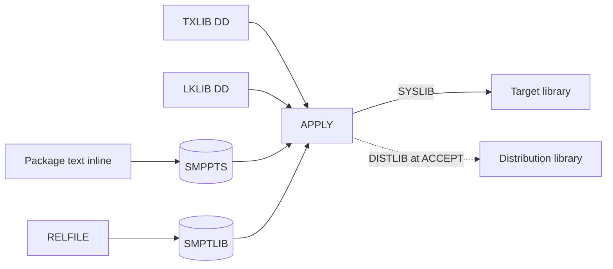

The lab function `JXYZ112` is a dependent function of `HXYZ110`. It carries a JCLIN section (explained from How JCLIN processing works onwards), a module whose object text comes from `TXLIB(XYZOBJ)`, a macro, a source member and a data element:

<!-- include: labs/m03/mcs/JXYZ112.mcs -->

Reading it top to bottom:

- `++VER(Z038) FMID(HXYZ110)` makes it a dependent function. The base must already be installed in the zone.
- `++JCLIN` starts the installation job input. It ends at the next `++` in column 1.
- `++MOD` names `AXYZMOD` as the distribution library and `SXYZLOAD` as the target library. Its object text is member `XYZMOD1` of the data set behind the `XYZOBJ` DD in the APPLY job.
- `++MAC`, `++SRC` and `++DATA` carry their text inline, up to the next `++`.

Failure modes at this level: element text that begins with `++` in column 1 (SMP/E reads a new statement); a `TXLIB` member whose name differs from the element name; a `SYSLIB` or `DISTLIB` ddname with no DDDEF.

---

## Data Element MCS

A data element is any element that is not a macro, source, module or program: parameter members, tables, samples. The MCS chapter of the Reference lists the data types in a table and describes the plain `++DATA` type as data not covered by other types. `++DATA1` to `++DATA5` and `++DATA6xxx` are reserved for IBM use, and `++USER1` to `++USER5` are for user-defined types.

The data element entry in the target zone carries, as the Reference documents it:

| Subentry | Meaning |
|---|---|
| name | Element name; may include `$`, `#`, `@` |
| `ALIAS` | Alternate names |
| `DISTLIB` | Required. Without it SMP/E cannot process changes. |
| `FMID` | The function that last replaced the element |
| `RMID` | The last SYSMOD that replaced the element; defaults to the FMID |
| `SYSLIB` | The target library ddname (one value only) |

The statement operands of `++DATA` itself were not confirmed for this article. The lab uses the same shape as `++MAC`: `DISTLIB`, `SYSLIB` and inline text (see `XYZPARM` in `JXYZ112`).

JCLIN handles data elements only for libraries that are copied in total. The data library therefore needs a copy step in JCLIN, described under JCLIN - DLIB entries.

---

## Program Element MCS

A program element is described by `++PROGRAM`. The Reference states that `DISTLIB` gives the distribution library ddname and `SYSLIB` the target library ddname, as for the other elements. A program element has its own entry type (PROGRAM) in the distribution and target zones.

The operand list, where the text can live and how a program element differs from a module element (which is link-edited under JCLIN control) were not confirmed for this article. The shape below is for orientation only; no lab installs a program element:

```
++PROGRAM(XYZPROG) DISTLIB(AXYZMOD) SYSLIB(SXYZLOAD) TXLIB(XYZOBJ) .
```

Confirm the operands in the Reference before you package one.

---

## Identifying the target system structure

JCLIN describes the structure of the target libraries to SMP/E. Before you write or read JCLIN, know which distribution library feeds which target library, and which elements are link-edited and which are copied. For product XYZ the structure is:

| Element kind | Distribution library (DDDEF) | Target library (DDDEF) | How it gets there |
|---|---|---|---|
| Macros | `AXYZMAC` | `SXYZMAC` | Element MCS and `SYSLIB` |
| Source | `AXYZSRC` | `SXYZSRC` | Element MCS and `SYSLIB` |
| Modules | `AXYZMOD` | `SXYZLOAD` | Link-edit in JCLIN |
| Data | `AXYZDATA` | `SXYZDATA` | Total copy in JCLIN |

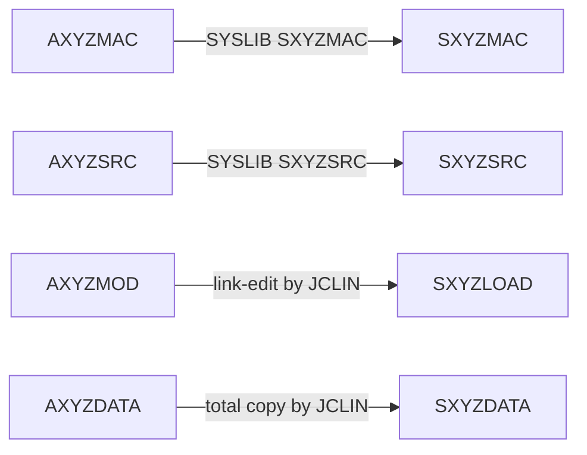

For a real product, the Program Directory and the JCLIN shipped in the function describe this structure. In the labs both the ddname and the data set name on every JCLIN DD statement match a DDDEF in the target zone, so the labs work however SMP/E resolves a JCLIN DD statement. Which of the two SMP/E uses was not confirmed for this article; read the User's Guide before you rely on either.

---

## How JCLIN processing works

JCLIN initializes entries in the target zone or the distribution zone with the data SMP/E needs to install elements. SMP/E derives that data by scanning a job stream of assembly, copy and link-edit steps. It does not run any step, and it does not change a library.

JCLIN reaches SMP/E in two ways:

- Inline, as `++JCLIN` in a SYSMOD. APPLY processes it into the target zone before it processes any element. ACCEPT processes it into the distribution zone only when the `DLIBZONE` entry carries `ACCJCLIN`.
- By the JCLIN command (Invoking JCLIN), which updates the zone named by `SET BDY`.

Programs JCLIN recognizes without help:

| Step type | Recognized programs |
|---|---|
| Assembler | `ASMBLR`, `ASMA90`, `IEUASM`, `IEV90`, `IFOX00`; procedure `ASMS` |
| Copy | `IEBCOPY` |
| Link-edit | `HEWL`, `HEWLH096`, `HEWLKED`, `IEWBLINK`, `IEWL`, `LINKEDIT`; procedure `LINKS` |
| Update | `IEBUPDTE` |

A program outside these lists is named with the `ASM`, `COPY`, `LKED` or `UPDATE` operand, on the JCLIN command or on `++JCLIN`.

What each step contributes:

| Step | Entries it is expected to create |
|---|---|
| Assembly | An ASSEM entry holding the assembler input, and the MOD entry for the module |
| Link-edit | An LMOD entry, with its link-edit control statements, and the MOD entries it includes |
| Copy with `SELECT` | LMOD entries for the selected members |
| Copy of a whole library | A DLIB entry |

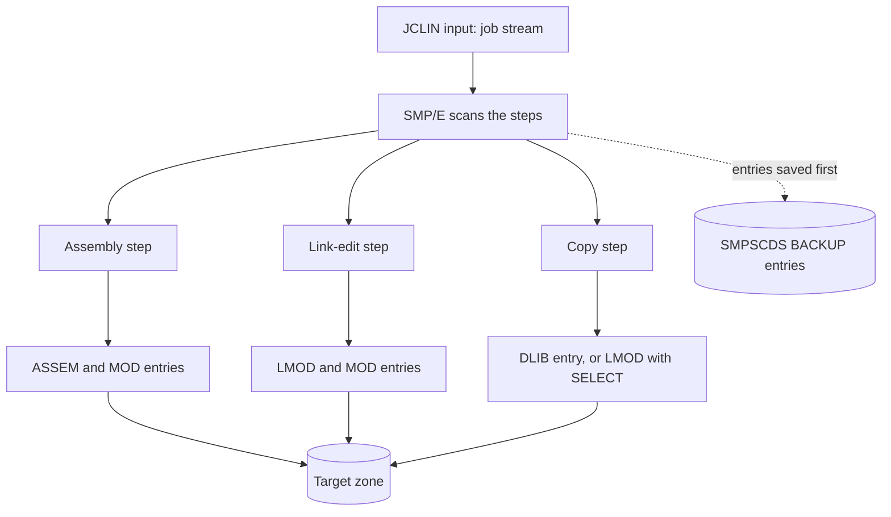

Before APPLY changes entries through inline JCLIN it saves the affected entries as BACKUP entries on `SMPSCDS`. Inline JCLIN is skipped for a SYSMOD that is superseded or deleted, and the `NOJCLIN` operand on APPLY suppresses it for all SYSMODs or for a list. Conditional JCLIN comments, shown in Invoking JCLIN, let one stream serve several cases.

---

## JCLIN processing example

The sample stream `JCLINDEM` has one assembly step and one link-edit step for a throwaway module `XYZDMOD` in a load module `XYZDEMO`. It is JCLIN input, not a job to submit. M03-L02 feeds it to the JCLIN command and then removes what it created.

<!-- include: labs/m03/jcl/M03L02-JCLINDEM.jcl -->

`SMPEJCLN` reads a JCL member, or an MCS member with a `++JCLIN` section, and prints what it expects JCLIN to create before you run anything. It classifies each step by program name using the lists above, and warns about a link-edit step with no `SYSLMOD`, an assembly step with no `SYSLIN` member, `SYSLIB` on a link-edit step without CALLLIBS, and a program JCLIN does not recognize. It is untested on z/OS and predicts from the step text only; SMP/E decides what it really creates.

<!-- include: rexx/SMPEJCLN.rexx -->

For `JCLINDEM` the utility should report two steps: `ASMD` (assembly, member `XYZDMOD`) and `LNKD` (link-edit, LMOD `XYZDEMO`, including `AXYZMOD(XYZDMOD)`), with no warnings.

---

## JCLIN report example

The JCLIN command writes a JCLIN report by default (`JCLINREPORT`; `NOJCLINREPORT` turns it off). APPLY accepts the same two operands for inline JCLIN. The report describes the entries the command added or changed.

Run M03-L02 and read the report against the `SMPEJCLN` prediction. For each step note the entry type, the entry name and the libraries it names. Save the full job output to `labs/expected/M03L02-JCLRUN.txt`. This article does not reproduce the report layout because no report was captured on a live system.

If the report names no entry for a step, SMP/E did not classify the step. Check the program name against the recognized list and use the `ASM`, `COPY`, `LKED` or `UPDATE` operand for a program outside it.

---

## JCLIN - MAC and ASSEM entries

An assembly step in JCLIN produces an ASSEM entry. The Reference describes it as follows:

| Subentry | Meaning |
|---|---|
| name | 1 to 8 characters; matches the module the entry can reassemble |
| assembler input | The saved assembler statements, delimited by `++ASMIN` and `++ENDASMIN` |
| `LASTUPD` | Cause of the last change: `JCLIN`, `UCLIN` or a SYSMOD ID |
| `LASTUPDTYPE` | `ADD` or `UPD` |

ASSEM and SRC entries are related to the MOD entry of the same name implicitly, not through a subentry. `++MAC` and `++MACUPD` carry the `ASSEM` operand, which controls which modules are reassembled when the macro changes; Module 5 covers it. On APPLY, the `ASSEM` operand makes SMP/E assemble the source of a module for which the SYSMOD supplies both source and object, in place of using the object.

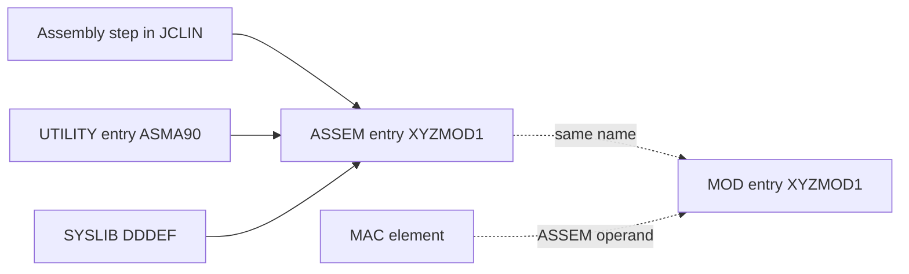

In the lab, the `ASM1` step of `JXYZ112` produces an ASSEM entry for `XYZMOD1` whose assembler input is the inline source. Reassembly needs the `ASMA90` UTILITY entry (M02-L01) and the `SYSLIB` DDDEF (this module).

---

## JCLIN - MOD and LMOD entries

A link-edit step produces an LMOD entry and the MOD entries of the modules it includes. The link-edit control statements in `SYSLIN` (`INCLUDE`, `ENTRY`, `ALIAS`, `NAME`) and the `PARM` string are kept so SMP/E can link-edit the load module again.

```
//LINK1    EXEC PGM=IEWL,PARM='XREF,LIST,LET'
//SYSLMOD  DD DSN=SMPE.LAB.SXYZLOAD,DISP=SHR
//SYSLIN   DD *
  INCLUDE AXYZMOD(XYZMOD1)
  NAME XYZLMOD1(R)
```

Subentries of the LMOD entry documented in the Reference, those this course uses:

| Subentry | Meaning |
|---|---|
| `SYSLIB` | ddnames of the target libraries where the load module resides |
| `LEPARM` | Link-edit attributes (the `PARM` string) |
| `LECNTL` | Link-edit control records needed to link-edit the load module again |
| `RC` | Highest acceptable link-edit return code |
| `CALLLIBS` | DDDEF names that make up the SYSLIB allocation for the link-edit (Module 6) |
| `MODDEL` | Modules once part of the load module and since deleted |
| `LMODALIAS` | Alias names |
| `COPIED` | Whether the load module was copied during system generation |
| `UTIN` | Utility input subentries, `filename,ddname` |

The only way to change the link-edit attributes of a load module that was link-edited at initial installation is to supply JCLIN input. The subentries of the MOD entry were not confirmed for this article; expect it to name its distribution library, its target library and the LMOD entries that contain it, and confirm with `LIST MOD`.

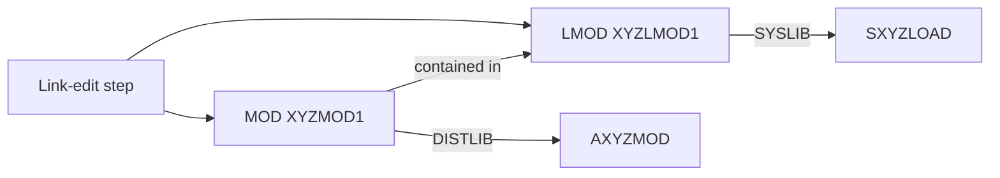

---

## JCLIN - DLIB entries

A copy step that copies a whole library produces a DLIB entry. The Reference describes DLIB entries as the way SMP/E tracks libraries that are totally copied during product installation. A DLIB entry is not connected to other target zone entries.

| Subentry | Meaning |
|---|---|
| name | The distribution library name |
| `SYSLIB` | The target ddnames. Module DLIBs take one or two; macro, source and data element DLIBs take one. |
| `LASTUPD`, `LASTUPDTYPE` | As for the ASSEM entry |

Data elements reach their target library only this way: JCLIN handles data elements only for totally copied libraries. In `JXYZ112` the step is:

```
//COPY1    EXEC PGM=IEBCOPY
//AXYZDATA DD DSN=SMPE.LAB.AXYZDATA,DISP=SHR
//SXYZDATA DD DSN=SMPE.LAB.SXYZDATA,DISP=SHR
//SYSIN    DD *
  COPY INDD=AXYZDATA,OUTDD=SXYZDATA
```

There is no `SELECT`, so the whole library is copied; the expected result is a DLIB entry `AXYZDATA` whose `SYSLIB` is `SXYZDATA`. That copy steps without `SELECT` produce DLIB entries is this course's reading of the Reference; confirm with `LIST DLIB`.

---

## Invoking JCLIN

The JCLIN command reads the input from the `SMPJCLIN` data set and updates the zone named by `SET BDY`. For inline JCLIN, `SET BDY` names the target zone (APPLY) or the distribution zone (ACCEPT, which also needs `ACCJCLIN` in the `DLIBZONE` entry).

Operands the Commands book documents for JCLIN:

| Operand | Meaning |
|---|---|
| `ASM`, `COPY`, `LKED`, `UPDATE` | Name a utility program or procedure that JCLIN does not recognize by default |
| `PGM` | A program name where a procedure name is expected |
| `CALLLIBS` | Process `SYSLIB` DD statements in link-edit steps. Without it they are ignored. |
| `JCLINREPORT`, `NOJCLINREPORT` | Write or suppress the JCLIN report. `JCLINREPORT` is the default. |
| `OPCODE(member)` | An `SMPPARM` member naming character strings treated as operation codes or macros |
| `RC` | Maximum return codes for the named commands. Must be the last operand. |

The syntax diagram is in the SMP/E Commands book.

Comment statements that JCLIN input may carry: `//*CALLLIBS=YES` after the job card (same effect as the `CALLLIBS` operand), conditional JCLIN with `//*SMPE-IF`, `//*SMPE-ELSE` and `//*SMPE-END`, and the `LIBRARYDD` and `SMPLTS` comments. Module 6 covers CALLLIBS.

The lab job runs the command against the sample stream and lists the three entries it should create:

<!-- include: labs/m03/jcl/M03L02-JCLRUN.jcl -->

`SMP.SMPJCLIN` adds a DD that `SMPPROC` does not define, so it has no override target in the procedure; it is added to the step.

---

## The save control dataset

`SMPSCDS` holds the information RESTORE needs to back a SYSMOD out of the target zone and the target libraries. During APPLY, SMP/E creates BACKUP entries there for the entries it changes: the entries touched by inline JCLIN, and the entries changed by `++MOVE`, `++DELETE` and `++RENAME` processing (load module deletions excepted). It is allocated as a PDSE in M01-L01.

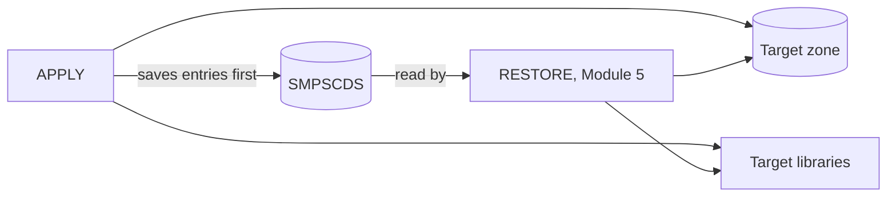

`SMPSCDS` is not a backup of the CSI or the libraries. If it is lost, RESTORE for the SYSMODs that depend on it cannot run. The lab backup job (shown under Product function and Installation methods) saves `SMPSCDS` together with the CSI so the two stay consistent. Once a SYSMOD is accepted, RESTORE no longer applies to it (M01-L03).

---

## Determining target libraries

For each element, SMP/E needs the target library to update:

- The `SYSLIB` operand on the element MCS names the target ddname. In all the labs the MCS names it.
- An element with no `SYSLIB` subentry goes to the target library that corresponds to its distribution library, as recorded through JCLIN.
- A macro or source change whose library is not a target library uses `SMPMTS` or `SMPSTS` as the fallback, which is why the DDDEF set includes them.
- A load module's target library comes from the `SYSLMOD` DD in the JCLIN link-edit step and is kept in the LMOD `SYSLIB` subentry.
- If the `SYSLIB` on a `++MAC` conflicts with the existing entry, SMP/E ignores the value unless `++MOVE` is used.
- `SMPLTS` holds base load modules for CALLLIBS processing.

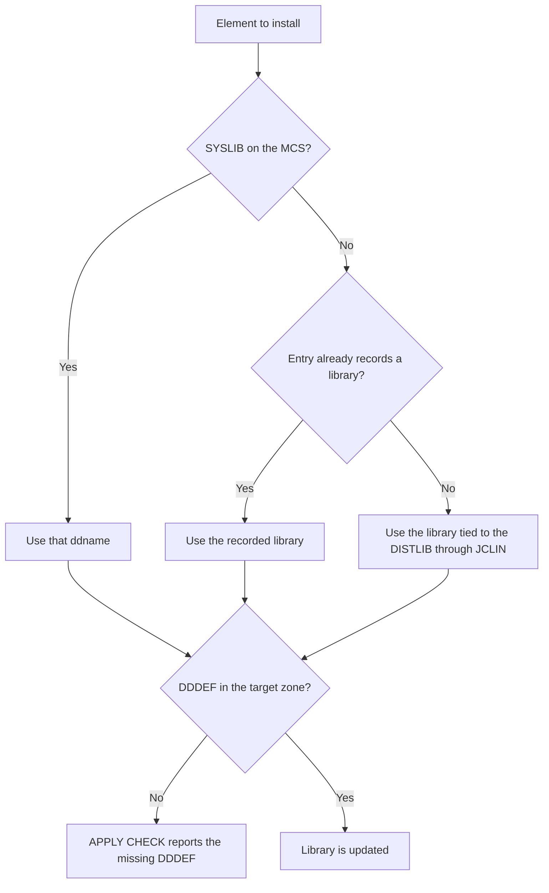

---

## Apply processing

APPLY selects received SYSMODs and installs them into the target libraries. The text comes from `SMPTLIB` (relative files), `SMPPTS` (inline text), or an indirect library (`TXLIB`, `LKLIB`), depending on the packaging.

In order, for each SYSMOD:

| Step | What SMP/E does | Typical failure |
|---|---|---|
| 1 | Checks that the SYSMOD can be applied: `++VER` SREL and FMID match the zone; not already applied; not partially restored; not superseded or deleted; PRE, REQ, IFREQ and NPRE conditions met; no unresolved HOLDDATA | SYSMOD not selected; message names the failed condition |
| 2 | Orders the SYSMODs by their PRE relationships. Without a PRE order: functions, then PTFs, APARs and USERMODs | Prerequisite not installed or in the same run |
| 3 | Processes inline JCLIN into the target zone and saves BACKUP entries on `SMPSCDS` | Unknown program in JCLIN; no UTILITY entry |
| 4 | Processes `++MOVE`, `++DELETE` and `++RENAME` | Module or element not found |
| 5 | Selects the elements to install by FMID, RMID and UMID checks | Element owned by another function |
| 6 | Installs the elements: macros, source, data, program and HFS elements with the copy or update utility; assemblies and module replacements with the link-edit utility, allocating `SYSLIB` and CALLLIBS libraries | Missing DDDEF or DD; out of space in a library; utility return code over its `RC` |
| 7 | Updates the target zone element, MOD, LMOD and SYSMOD entries, and records in the global zone that the SYSMOD was applied | None |

A SYSMOD that terminates ends with return code 8. A function SYSMOD termination, or an APPLY termination, ends with 12. As in RECEIVE, read `SMPOUT`; the return code alone does not show which SYSMODs were skipped.

`CHECK` runs the same selection and reports what would be installed without a permanent update. SMP/E writes temporary target zone data for the check and removes it afterwards.

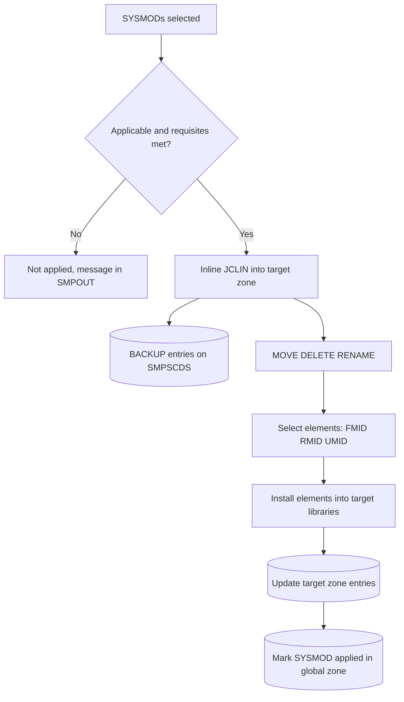

If a target library is managed by LLA in FREEZE mode, refresh LLA or use NOFREEZE after an APPLY; the Commands book gives the recommended procedures.

---

## Concatenating macro libraries for assemblies

When SMP/E assembles a module during APPLY, the `SYSLIB` data set is a concatenation of macro libraries. The Reference gives the order for APPLY and RESTORE:

1. `SMPMTS`
2. `MACLIB`
3. `MODGEN`
4. The target system macro libraries, such as the ones named for `SYSLIB` on `++MAC`
5. The distribution macro libraries, such as the ones named for `DISTLIB` on `++MAC`

For ACCEPT, the concatenation omits `SMPMTS` and the target macro libraries; Module 4 builds it. The sample cataloged procedure in the User's Guide notes that the APPLY and ACCEPT concatenations should point to different libraries, which is why each zone has its own `SYSLIB` DDDEF. The data set must be partitioned, `RECFM=FB`, `LRECL=80`, on direct access storage.

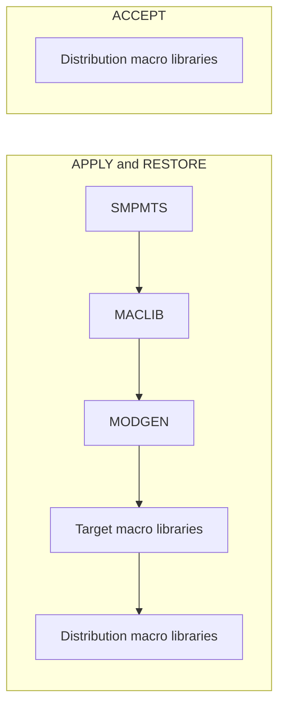

---

## SYSLIB DDDEF example

A concatenation is a DDDEF whose only operand is `CONCAT`, naming other DDDEF entries in the same zone:

```
UCLIN .
ADD DDDEF(SYSLIB) CONCAT(SMPMTS,MACLIB,MODGEN,SXYZMAC,AXYZMAC) .
ENDUCL .
```

Rules the Reference documents for `CONCAT`:

- Each name must be a DDDEF entry in the same zone. SMP/E does not look elsewhere for its allocation.
- Up to 123 names, subject to the operating system limit for concatenated partitioned data sets.
- No nesting: a `CONCAT` cannot name a DDDEF that itself has `CONCAT`.
- `CONCAT` is mutually exclusive with every other DDDEF operand.
- A data set defined `OLD` is allocated `SHR` in a concatenation.
- The order is the order in the entry. You cannot `ADD` to an existing list; use `REP` with the whole list.

That is why `TGT1` needed `DDDEF(AXYZMAC)` and `DDDEF(SMPMTS)` before the `SYSLIB` entry in M03-L01: every name in the list must already exist as a DDDEF. `LIST DDDEF(SYSLIB)` shows the list in order; confirm it before the first APPLY that assembles.

---

## The APPLY command

Operands used in this module and the ones next to them in the Commands book:

```
APPLY [SELECT(sysmod,...)] [EXCLUDE(sysmod,...)] [PTFS] [APARS]
      [FUNCTIONS] [USERMODS] [FORFMID(fmid,...)] [SOURCEID(id,...)]
      [GROUP | GROUPEXTEND] [BYPASS(...)] [CHECK] ... .
```

| Operand | Meaning |
|---|---|
| `SELECT` | Apply the named SYSMODs. Works regardless of other selection operands. |
| `EXCLUDE` | SYSMODs that must not be applied |
| `PTFS`, `APARS`, `FUNCTIONS`, `USERMODS` | Select all eligible SYSMODs of the type. With none given, only PTFs are processed. |
| `FORFMID` | Limit selection to SYSMODs for the FMIDs |
| `SOURCEID`, `EXSRCID` | Include or exclude by SOURCEID; `*` and `%` wildcards work |
| `GROUP` | Include unapplied PRE, REQ and IFREQ requisites of the candidates automatically |
| `GROUPEXTEND` | As `GROUP`, and substitute a superseding SYSMOD when a requisite is missing, held or in error. Examines more SYSMODs and may need more region. |
| `BYPASS` | Skip a check: `HOLDCLASS`, `HOLDERROR`, `HOLDFIXCAT`, `HOLDSYSTEM`, `HOLDUSER`, `ID`, `PRE`, `REQ`, `IFREQ`, `XZIFREQ` |
| `CHECK` | Dry run: tests for errors and reports the libraries to be updated and any regressions, without permanent updates |
| `COMPRESS` | `ALL` or a ddname list; compresses libraries that receive elements. Ignored with `CHECK`. |
| `ASSEM` | Assemble source in place of object when the SYSMOD has both |
| `REDO` | Reapply SYSMODs that are already applied. Requires `SELECT`. |
| `REUSE` | Reuse objects assembled earlier in `SMPWRK3`. SMP/E does not verify the SYSMOD set is unchanged. |
| `RETRY` | `YES` (default) retries after an out-of-space error when the OPTIONS entry has a `RETRYDDN` list |
| `FIXCAT` | Fix categories of interest (Module 7) |
| `JCLINREPORT`, `NOJCLINREPORT`, `NOJCLIN` | Control the JCLIN report and inline JCLIN |
| `XZREQ`, `XZGROUP` | Cross-zone requisites (Module 6) |
| `RC` | Maximum return codes for named commands. Must be the last operand. |

`SELECT` puts the command in select mode. Without it APPLY works in mass mode over everything eligible, which is why the labs always select. Operands combine into one candidate list. `SET BDY` must name the target zone before the command.

Apply `JXYZ112` as the User's Guide advises, with a CHECK run first:

<!-- include: labs/m03/jcl/M03L04-APPCHK.jcl -->

Read the CHECK report: it names the libraries the APPLY will update and reports a missing DDDEF, a missing requisite or a regression. Resolve those before the real run. Use `BYPASS` only once you understand the condition it hides, and keep `CHECK` on until the report is clean. Then the real run:

<!-- include: labs/m03/jcl/M03L04-APPLYFN.jcl -->

Common forms:

```
APPLY SELECT(UA00010) CHECK .
APPLY FORFMID(JXYZ112) FUNCTIONS PTFS GROUPEXTEND CHECK .
APPLY SOURCEID(LABM03) BYPASS(HOLDSYSTEM(ACTION)) .
```

---

## Target Zone SYSMOD entry example

The target zone SYSMOD entry records what was done when the SYSMOD was installed. In the global zone, the SYSMOD entry is updated to show the SYSMOD has been applied. Display both after M03-L04:

<!-- include: labs/m03/jcl/M03L04-LISTAPP.jcl -->

Read the target zone entry for the SYSMOD ID and type, the FMID, and the elements it installed. Read the global zone entry for the indication that `JXYZ112` was applied to `TGT1`. Subentry names for the target zone SYSMOD entry were not confirmed for this article; record the names you see in your own output. After M03-L04 the target zone lists `HXYZ110` and `JXYZ112` (and `UA00001` if you did M01-L03), and no listed SYSMOD is accepted by this module.

Save the output to `labs/expected/M03L04-LISTAPP.txt`.

---

## Element service level

Every element entry records which SYSMODs put it at its current level:

| Subentry | Meaning |
|---|---|
| `FMID` | The function that last replaced the element |
| `RMID` | The last SYSMOD that replaced the element. Defaults to the FMID. |
| `UMID` | SYSMODs that updated the element rather than replaced it (Module 5) |

When `JXYZ112` is applied, `XYZMAC9` has `FMID` and `RMID` both `JXYZ112`. When PTF `UA00010` replaces `XYZMAC9`, `FMID` stays `JXYZ112` and `RMID` becomes `UA00010`. The pair tells you which function owns an element and which service is on it. APPLY selects elements by comparing these values, and uses the same data to decide whether a SYSMOD regresses an element.

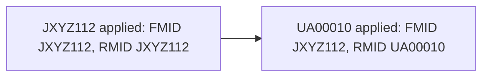

`UA00010` replaces a macro and the data element of the function:

<!-- include: labs/m03/mcs/UA00010.mcs -->

Receive and apply it in one job, with a CHECK run between:

<!-- include: labs/m03/jcl/M03L05-APPPTF.jcl -->

Module 5 builds on this: tracking service level, regression and RESTORE.

---

## Target Zone MAC and SRC element entries

After M03-L04 the target zone holds a MAC entry for `XYZMAC9` and an SRC entry for `XYZSRC2`. A macro or source entry is expected to carry, from the Reference description of the parallel data element entry:

| Subentry | Expected value in the lab |
|---|---|
| name | `XYZMAC9`, `XYZSRC2` |
| `DISTLIB` | `AXYZMAC`, `AXYZSRC` |
| `SYSLIB` | `SXYZMAC`, `SXYZSRC` |
| `FMID` | `JXYZ112` |
| `RMID` | `JXYZ112`; `XYZMAC9` becomes `UA00010` after M03-L05 |
| `LASTUPD` | The SYSMOD that last changed the entry |

The MAC and SRC subentry lists were not confirmed individually; compare with `LIST MAC` and `LIST SRC` output. An ASSEM or SRC entry has an implicit relationship with the MOD entry of the same name, not a subentry link. The target library members appear in `SMPE.LAB.SXYZMAC` and `SMPE.LAB.SXYZSRC`; the distribution library members are not there yet, because ACCEPT has not run.

---

## Target Zone MOD and DATA element entries

The MOD entry for `XYZMOD1` and the DATA entry for `XYZPARM` are created by the same APPLY.

| Entry | Expected content |
|---|---|
| MOD `XYZMOD1` | `DISTLIB` `AXYZMOD`, `FMID` `JXYZ112`, and the LMOD it is part of, `XYZLMOD1` |
| LMOD `XYZLMOD1` | `SYSLIB` `SXYZLOAD`, the link-edit control records from the JCLIN |
| DATA `XYZPARM` | `DISTLIB` `AXYZDATA`, `SYSLIB` `SXYZDATA`, `FMID` and `RMID` `JXYZ112`; `RMID` becomes `UA00010` after M03-L05 |
| DLIB `AXYZDATA` | `SYSLIB` `SXYZDATA` |
| ASSEM `XYZMOD1` | The assembler input from the JCLIN |

The DATA entry layout matches the Reference (see Data Element MCS). The MOD entry subentries were not confirmed; compare with `LIST MOD`. `SXYZLOAD` contains `XYZLMOD1`, and `SXYZDATA` contains `XYZPARM`.

---

## Base and dependent functions revisited

Every SYSMOD except a base function names an FMID on `++VER`, and APPLY requires that function to be installed in the zone, or installed in the same run. A SYSMOD must also have a `++VER` whose SREL matches the zone.

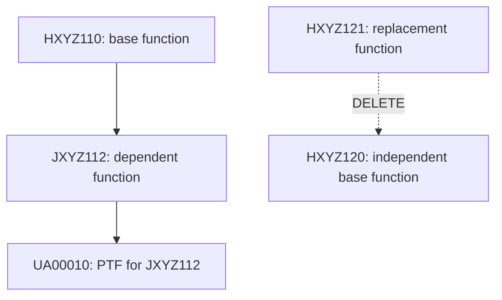

Three functions in the labs show the cases:

- `HXYZ110` and `HXYZ120` are base functions: neither names an FMID. They install independently.
- `JXYZ112` is a dependent function of `HXYZ110`. APPLY needs `HXYZ110` in `TGT1`, which M01-L02 provided.
- A PTF names its function: `UA00010` names `JXYZ112`.

`HXYZ120` was received from a relative file in M02-L04 and has not been applied. Applying it tests the `SMPTLIB` path from Module 2:

<!-- include: labs/m03/jcl/M03L06-APPBASE.jcl -->

Apply a function with its PTFs and requisites in one command where possible: `FORFMID` with `FUNCTIONS`, `PTFS` and `GROUPEXTEND` selects the function, its service and the requisites SMP/E needs in one pass.

---

## Replacing an existing product

A function can delete another with the `DELETE` operand on `++VER`, valid only in functions. When SMP/E applies it, the deleted function, the SYSMODs that depend on it and their elements are removed from the target libraries and the target zone. For explicitly deleted SYSMODs SMP/E creates target zone entries with a `DELBY` subentry that names the deleting function.

The deletion cannot be undone by RESTORE: if one product deletes another, RESTORE of the new product does not bring the old one back. Treat a replacement as one-way. Take a backup, run CHECK, read the report for what will be removed, then APPLY.

`HXYZ121` replaces `HXYZ120`:

<!-- include: labs/m03/mcs/HXYZ121.mcs -->

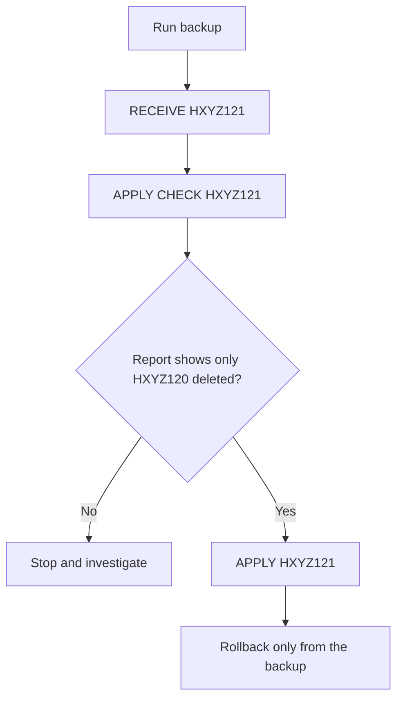

Receive and check:

<!-- include: labs/m03/jcl/M03L06-REPCHK.jcl -->

Then apply:

<!-- include: labs/m03/jcl/M03L06-REPAPPL.jcl -->

After the APPLY, `HXYZ120` is no longer in the target zone, `XYZMAC2` is at the `HXYZ121` level and `HXYZ121` carries the element.

---

## Sysmod installation via the SMP/E dialog

The SMP/E dialogs build and run the same jobs. To install a SYSMOD with APPLY you select the SMP/E zone, choose the SYSMOD management option for APPLY, name the SYSMODs, choose whether it is a CHECK run, review the generated job and submit it. The panel names and option numbers vary by SMP/E level; verify them on your system.

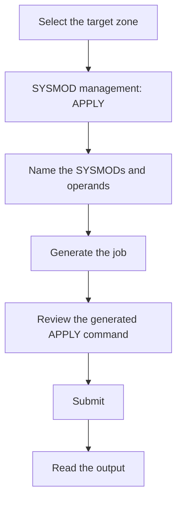

The generated job contains an `APPLY` command like the ones in this module. Use it as a check on your batch syntax: set the CHECK option first, view the generated job, then compare it with `M03L04-APPCHK`.

---

## SMP/E dialogs - sysmod management options

The SYSMOD management options cover the SYSMOD commands from Modules 2 to 5. Dialog tasks and the batch commands they correspond to:

| Task in the dialog | Batch command |
|---|---|
| Receive SYSMODs or HOLDDATA | `RECEIVE` |
| Apply | `APPLY`, with `CHECK` for the dry run |
| Accept | `ACCEPT` (Module 4) |
| Restore | `RESTORE` (Module 5) |
| Reject | `REJECT` |
| Query SYSMODs, elements, DDDEFs | `LIST` |

Two things carry across levels:

- The dialog must know the CSI and the zone first, as `SET BDY` does in batch. Every action runs against the zone you chose.
- The dialog generates the job from your choices and shows it before it runs, so you can save the job and rerun it as a batch member.

---

## Hands-on labs

### M03-L01: Define the target zone libraries and DDDEFs

Goal: allocate the Module 3 libraries, define the target zone DDDEFs including the `SYSLIB` concatenation, read the `TARGETZONE` entry, and take a backup.

Prerequisites: M02-L01 and M01-L02 complete.

Steps:

1. Run `M03L01-ALLOCLIB` (shown under Target Zone DDDEF entry). Replace `&VOL` first.
2. Upload `M03L01-TZDDDEF.smpcntl` to `SMPE.LAB.SMPCNTL` as member `TZDDDEF`. Upload the `.jcl` files of this lab to `SMPE.LAB.JCL` under the member names in `labs/manifest.json`.
3. Run `M03L01-TZRUN` (shown under Target Zone DDDEF entry example).
4. Run `M03L01-LISTTZ` (shown under TZONE entry example).
5. Run `M03L01-BACKUP` (shown under Product function and Installation methods). Replace `&VOL`.

Expected result: the allocation job, `TZRUN` and the backup end with return code 0. `LIST TARGETZONE` shows `SREL` `Z038`, `OPTIONS` `GLOBOPT` and `RELATED` `DLB1`. The DDDEF listing for `TGT1` has the nine DDDEFs added here, `SYSLIB` among them as `SMPMTS MACLIB MODGEN SXYZMAC AXYZMAC` in that order, and the five from M01 and the ten work-file DDDEFs from M02, 24 in all. There is no DDDEF for `SXYZDATX`.

Verification: run `SMPESCAN` on the SMPOUT of `TZRUN` and `LISTTZ`. Save the `LISTTZ` output to `labs/expected/M03L01-LISTTZ.txt`.

Troubleshooting: a message that a DDDEF exists means use `REP`. A message that a name in `CONCAT` is not a DDDEF means a DDDEF listed before it in the table in Target Zone DDDEF entry is missing in `TGT1`. A failure in the backup job for a data set that already exists means a previous backup is still cataloged; the first step of the job deletes the old copies, so check that step's output.

Rollback: restore from the backup. Run `M03L01-RESTORE` (no SMP/E job may be running; replace `&VOL`). It deletes and recreates the CSI and the six libraries from the last backup, so it returns the environment to the state at the last run of `M03L01-BACKUP`:

<!-- include: labs/m03/jcl/M03L01-RESTORE.jcl -->

### M03-L02: Run the JCLIN command on a sample stream

Goal: see the entries JCLIN creates from assembly and link-edit steps, without installing anything.

Prerequisites: M03-L01 complete.

Steps:

1. Upload `M03L02-JCLINDEM.jcl` to `SMPE.LAB.JCL(JCLINDEM)` and `SMPEJCLN.rexx` to `SMPE.LAB.EXEC(SMPEJCLN)`.
2. Run `SMPEJCLN 'SMPE.LAB.JCL(JCLINDEM)'` from TSO. Compare with the prediction in JCLIN processing example.
3. Run `M03L02-JCLRUN` (shown under Invoking JCLIN).
4. Read the JCLIN report in the job output and the three `LIST` results.

Expected result: `SMPEJCLN` ends with return code 0. The JCLIN job ends with return code 0, or 4 with warnings you can explain from the messages. The report and the `LIST` commands show a MOD entry and an ASSEM entry for `XYZDMOD` and an LMOD entry `XYZDEMO` whose `SYSLIB` is `SXYZLOAD`. No library changed.

Verification: run `SMPESCAN` on the SMPOUT. Save the job output to `labs/expected/M03L02-JCLRUN.txt`.

Troubleshooting: if the report names no entry for a step, check the program name against the recognized list; if SMP/E reports a missing UTILITY entry, confirm `ASMA90` and `IEWL` exist (M02-L01).

Rollback: remove the three entries with UCLIN:

<!-- include: labs/m03/jcl/M03L02-UNDOJCL.jcl -->

### M03-L03: Package and receive a function with JCLIN

Goal: build the object text that `JXYZ112` delivers through `TXLIB`, and receive the function.

Prerequisites: M03-L01 complete.

Steps:

1. Upload `JXYZ112.mcs` to `SMPE.LAB.SMPPTFIN(JXYZ112)`.
2. Run `SMPEMCS 'SMPE.LAB.SMPPTFIN(JXYZ112)'`. Expected: no errors.
3. Run `SMPEJCLN 'SMPE.LAB.SMPPTFIN(JXYZ112)'`. Expected: three steps: `ASM1` (assembly, `XYZMOD1`), `LINK1` (link-edit, LMOD `XYZLMOD1`) and `COPY1` (total copy, `AXYZDATA`), with no warnings.
4. Run `M03L03-BLDOBJ`, which assembles `XYZMOD1` into `SMPE.LAB.XYZOBJ`.
5. Run `M03L03-RCVFUNC`.

`M03L03-BLDOBJ`:

<!-- include: labs/m03/jcl/M03L03-BLDOBJ.jcl -->

`M03L03-RCVFUNC`:

<!-- include: labs/m03/jcl/M03L03-RCVFUNC.jcl -->

Expected result: `BLDOBJ` ends with return code 0 and member `XYZMOD1` exists in `SMPE.LAB.XYZOBJ`. RECEIVE ends with return code 0. `LIST SYSMODS` shows `JXYZ112` in RECEIVED status with SOURCEID `LABM03`. `TGT1` is unchanged.

Verification: browse `SMPE.LAB.SXYZLOAD`: still empty.

Troubleshooting: if RECEIVE skips `JXYZ112` because its base function is not in the global zone, the cause is the carry-over described in the prerequisites: the global zone has no entry for the accepted `HXYZ110`, and whether the `FMID(HXYZ110)` subentry in the `GLOBALZONE` entry stands in for it is unconfirmed. Record the message, then rerun RECEIVE with `BYPASS(FMID)` and note that you did.

Rollback: `REJECT SELECT(JXYZ112) .` in the global zone.

### M03-L04: APPLY CHECK and APPLY the function

Goal: install `JXYZ112` and see the entries JCLIN and the element MCS create.

Prerequisites: M03-L03 complete; `HXYZ110` applied in `TGT1`.

Steps:

1. Upload the `.jcl` files of this lab to `SMPE.LAB.JCL`.
2. Run `M03L04-APPCHK` (shown under The APPLY command). Read the report for the libraries to be updated, and confirm no missing DDDEF or requisite.
3. Run `M03L04-APPLYFN`.
4. Run `M03L04-LISTAPP` (shown under Target Zone SYSMOD entry example).

Expected result: both APPLY jobs end with return code 0. The CHECK run changes nothing. After the APPLY: `SMPE.LAB.SXYZLOAD` has member `XYZLMOD1`, `SXYZMAC` has `XYZMAC9`, `SXYZSRC` has `XYZSRC2`, `SXYZDATA` has `XYZPARM`. The target zone has the entries in the table under Target Zone MOD and DATA element entries, plus MAC and SRC entries for the macro and source. The distribution libraries `AXYZMOD`, `AXYZDATA`, `AXYZMAC` and `AXYZSRC` have not changed.

Verification: run `SMPESCAN` on both jobs. Save the CHECK output and the `LISTAPP` output to `labs/expected/M03L04-APPCHK.txt` and `labs/expected/M03L04-LISTAPP.txt`.

Troubleshooting: a missing DDDEF names the ddname; compare with the table in Target Zone DDDEF entry. A message that the `XYZOBJ` member is not found means `BLDOBJ` did not run or the `SMP.XYZOBJ` DD points elsewhere. A utility return code over its limit means the `RC` on the matching UTILITY entry (M02-L01) is lower than the utility ended with.

Rollback: `RESTORE SELECT(JXYZ112) .` in `TGT1`; the SYSMOD is not accepted, so RESTORE applies. `SMPEJOB TGT1 RESTORE SELECT(JXYZ112) .` builds and submits the job. Restore from the backup if RESTORE fails.

### M03-L05: Apply a PTF and read the element service level

Goal: apply a PTF to the function and watch the `RMID` of the elements change.

Prerequisites: M03-L04 complete.

Steps:

1. Upload `UA00010.mcs` to `SMPE.LAB.SMPPTFIN(UA00010)`.
2. Run `M03L05-APPPTF` (shown under Element service level).
3. Compare the `LIST MAC(XYZMAC9)` and `LIST DATA(XYZPARM)` output with the entries before the PTF.

Expected result: all three steps end with return code 0. `XYZMAC9` and `XYZPARM` have `FMID` `JXYZ112` and `RMID` `UA00010`. `XYZMOD1` and `XYZSRC2` are unchanged. `SXYZMAC(XYZMAC9)` has the extra `PTF10` line.

Verification: browse `SMPE.LAB.SXYZDATA(XYZPARM)`: it contains `PTF=UA00010`.

Troubleshooting: if the PTF is not eligible, `JXYZ112` is not applied or the SREL differs from the zone.

Rollback: `SMPEJOB TGT1 RESTORE SELECT(UA00010) .`, or `REJECT SELECT(UA00010) .` in the global zone once it is restored.

### M03-L06: Apply a base function and replace it

Goal: apply the function received in Module 2, then replace it with a function that deletes it, and see why only the backup undoes the replacement.

Prerequisites: M03-L01 and M02-L04 complete.

Steps:

1. Run `M03L01-BACKUP` again, so the backup holds the state before this lab.
2. Upload `HXYZ121.mcs` to `SMPE.LAB.SMPPTFIN(HXYZ121)`.
3. Run `M03L06-APPBASE` (shown under Base and dependent functions revisited).
4. Run `M03L06-REPCHK` (shown under Replacing an existing product). Read the CHECK report for what will be deleted.
5. Run `M03L06-REPAPPL`.

Expected result: `APPBASE` ends with return code 0 and `XYZMAC2` appears in `SXYZMAC` at the `REL1` level. The CHECK report names `HXYZ120` as deleted by `HXYZ121`. After `REPAPPL`, `LIST SYSMODS` shows `HXYZ121` and no `HXYZ120`, and `XYZMAC2` is at the `REL2` level.

Verification: run `SMPESCAN` on each job; save the CHECK output to `labs/expected/M03L06-REPCHK.txt`.

Troubleshooting: if `APPBASE` cannot find the text, the `SMPTLIB` data sets from M02-L04 were deleted or renamed; redo M02-L04.

Rollback: `RESTORE` does not bring `HXYZ120` back. Run `M03L01-RESTORE`, which returns the environment to the backup taken in step 1.

### M03-L07: Diagnose SYSMODs that APPLY refuses

Goal: learn two ways APPLY CHECK refuses a SYSMOD and fix one of them.

Prerequisites: M03-L04 complete.

Steps:

1. Upload `UA00011.mcs`, `UA00012.mcs` and `M03L07-FIXDD.smpcntl` (as member `FIXDD` in `SMPE.LAB.SMPCNTL`).
2. Run `M03L07-RCVAPP`.
3. For each CHECK step run `SMPESCAN` and record the highest return code, the message IDs and what each message says is wrong. Look each message ID up in the SMP/E Messages, Codes, and Diagnosis book.
4. Run `M03L07-RERUN`, which adds the missing DDDEF and repeats the CHECK, and shows a bypass.

`M03L07-RCVAPP`:

<!-- include: labs/m03/jcl/M03L07-RCVAPP.jcl -->

`M03L07-RERUN`:

<!-- include: labs/m03/jcl/M03L07-RERUN.jcl -->

The two PTFs:

<!-- include: labs/m03/mcs/UA00011.mcs -->

<!-- include: labs/m03/mcs/UA00012.mcs -->

Expected result:

| SYSMOD | Fault | Expected outcome |
|---|---|---|
| `UA00011` | Prerequisite `UA00090` is not received | CHECK reports the unsatisfied prerequisite; the SYSMOD is not eligible |
| `UA00012` | Target library `SXYZDATX` has no DDDEF | CHECK reports the missing DDDEF; nothing is installed |

After `M03L07-RERUN`, the CHECK for `UA00012` is clean. The CHECK for `UA00011` with `BYPASS(PRE)` runs the SYSMOD past the missing prerequisite, which is wrong in real work: it hides a condition without resolving it. Neither PTF is applied: every APPLY in this lab has `CHECK`. Capture the first job's output in `labs/expected/M03L07-RCVAPP.txt`.

Troubleshooting: if `UA00011` receives but `UA00012` is skipped, read the `SMPOUT` of RECEIVE; a RECEIVE return code of 4 does not show which SYSMOD was skipped.

Rollback: `REJECT SELECT(UA00011,UA00012) .` in the global zone. The added `DDDEF(SXYZDATX)` can stay or go: `DEL DDDEF(SXYZDATX)` under UCLIN in `TGT1`.

### M03-L08: Apply a SYSMOD with the SMP/E dialogs

Goal: repeat an APPLY CHECK from the dialogs and compare the generated job with `M03L04-APPCHK`.

Prerequisites: M03-L05 complete; the dialogs are installed on your system.

Steps:

1. Start the SMP/E dialogs as your site documents.
2. Identify the CSI `SMPE.LAB.CSI` and select the target zone `TGT1`.
3. Choose the APPLY action under SYSMOD management and select `UA00010`. Set the CHECK option.
4. View the generated job without submitting it.
5. Compare it with `M03L04-APPCHK`: the `SET BDY`, the `APPLY SELECT(UA00010) CHECK` and the DDs.

Expected result: the generated job holds the same `SET BDY(TGT1)` and `APPLY` command as the batch version. `UA00010` is already applied, so a submitted CHECK reports that it is applied; do not submit a real APPLY.

Record: the menu path you used for each step. Add it to `labs/expected/M03L08-dialog-path.txt`.

---

## Review questions

1. Which zone does APPLY update first, and which libraries does it change? Which libraries does it not touch?
2. Why does `JXYZ112` need a DDDEF for the distribution library `AXYZMOD` in the target zone?
3. What does `CHECK` do, and what does SMP/E write while it runs?
4. State what JCLIN creates from an assembly step, a link-edit step and a copy step of a whole library.
5. Does JCLIN run the steps it reads? Which command runs it, and which zone does `SET BDY` name?
6. What is saved on `SMPSCDS`, and at what point in APPLY?
7. In what order is the `SYSLIB` concatenation built for APPLY? What is left out for ACCEPT?
8. Why can you not `ADD` a library to an existing `CONCAT` list?
9. Without `SELECT`, which SYSMODs does APPLY process? Why do the labs always use `SELECT`?
10. After `UA00010` is applied, what are the `FMID` and `RMID` of `XYZMAC9`? Of `XYZSRC2`?
11. What happens to `HXYZ120` when `HXYZ121` is applied? Can RESTORE bring it back?
12. A CHECK run reports a missing DDDEF. Which commands correct it, and where do you define it?

---

<!-- sources -->
